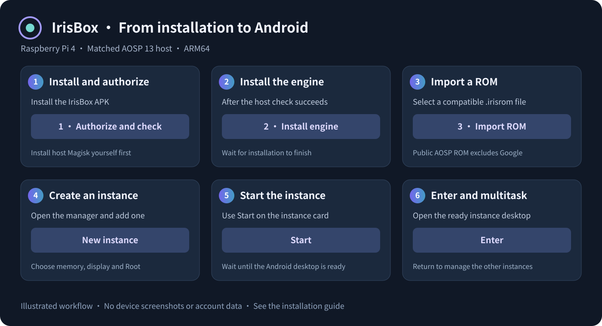
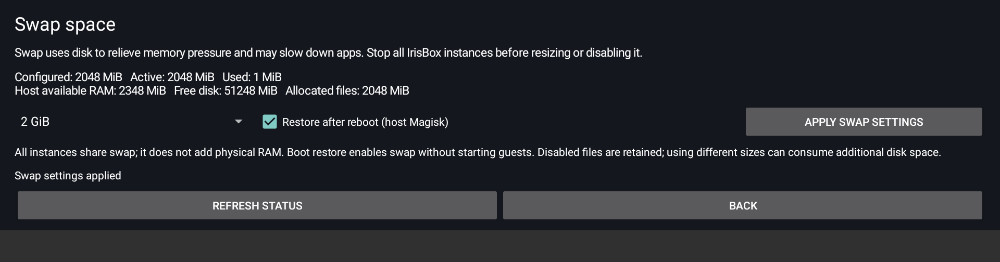

# IrisBox · Android Container

[简体中文](README.zh-CN.md) · **English** · [Downloads & SHA-256](DOWNLOADS.md) · [GitHub Releases](https://github.com/582835293/IrisBox/releases)

**IrisBox (虹膜空间)** runs multiple isolated Android userspaces inside a rooted Raspberry Pi 4 Android host. Instances share the host Linux kernel while maintaining separate namespaces (User / Mount / PID / Network / IPC / UTS / Cgroup), private BinderFS instances, OverlayFS write layers, and independent app data.

> [!IMPORTANT]
> **Preview Scope & Upgrade Requirements (v0.1.6 / Engine e27)**
> - **Matched Host Profile Only**: Requires a **Raspberry Pi 4 (ARM64, ~4 GiB RAM)** running the exact matched **Raspberry Vanilla AOSP 13** build with Wi-Fi and an already configured **Permissive** SELinux environment. Root access alone does not make other boards or arbitrary Android ROMs compatible.
> - **User-Installed Host Magisk**: Install host Magisk yourself following upstream instructions and the board's boot partition layout. IrisBox never installs or patches host Magisk.
> - **Mandatory Migrations for Existing Users**:
>   - Existing `0.1.4 / e21` installations must complete the stopped-state [0.1.5 Namespace Migration and Recovery](docs/en/namespace-migration.md) and grant normal host root to the new `com.irisbox.viewer` package.
>   - Existing `0.1.2 / e13` installations must complete the stopped-state [User Namespace Isolation and Migration](docs/en/userns.md) before starting instances.

---

## Key Capabilities

| Area | Summary |
| :--- | :--- |
| **Multi-Instance Isolation** | Independent app data, configurable memory ceilings (`0.5`–`2.5 GiB`), resolution presets, live orientation switching (`Follow app` / `Landscape` / `Portrait`), and lifecycle controls. |
| **User Namespace Identity** | Every instance runs in a dedicated User namespace (`0.1.3+`). Guest `root (UID 0)` maps to an unprivileged host UID block (`2000000000+`) with **no Host-UID0 fallback**. |
| **Verified ROM Import** | Enforces path safety, size bounds, manifest structure, and per-file SHA-256 checks. Extracts regular files only—no installer scripts from ROM archives are ever executed. |
| **Host Swap Control (v0.1.6)** | App-managed shared host swap (`Off` / `1 GiB` / `2 GiB` / `4 GiB`) with optional automatic restoration across host reboots via user-installed host Magisk. |
| **Display, Input & Media** | ~1 fps live list previews; shared-buffer fullscreen rendering with fence synchronization; mouse/keyboard/touch input modes; per-instance 48 kHz PCM audio playback and software video decoding. |
| **File Exchange & Localization** | Per-instance SAF file import/export (`Downloads/IrisExchange`); persistent host App UI language selector (`System default` / `English` / `简体中文`) independent of guest Android locales. |
| **Optional Guest Root & Google** | **Guest Root (Magisk)**: Bundled adapted component with per-instance toggle and rescue startup mode (separate from host Magisk). **Google Layer**: The public AOSP ROM excludes Google apps and accounts. Optional Google support accepts separately supplied, properly licensed matching components; existing private Google instances retain their ROM and sign-in state. |

---

## Quick Start

*Note: The diagram above illustrates the workflow and contains no account or device data.*

1. **Verify the Host**: Read the [Installation and Host Image Guide](docs/en/installation.md) to confirm the matched build fingerprint, kernel namespaces, GPU stack, Wi-Fi, and Permissive setup.
2. **Prepare Host Root**: Install **host Magisk yourself** according to the Raspberry Pi boot partition layout.
3. **Install the Engine**: Install `IrisBox-0.1.6.apk`, open IrisBox, and select **1 · Authorize and check**, then **2 · Install engine**.
4. **Import a Compatible ROM**: Select **3 · Import ROM** and pick `IrisBox-rpi4-a13-aosp.irisrom`.
5. **Create & Launch an Instance**: Open **4 · Manage instances** → **New instance** → **Start**, wait for **Desktop ready**, and select **Enter**.

---

## Device Captures & Validation Highlights

> [!NOTE]
> All screenshots below are real device captures cropped and privacy-redacted with the owner's permission (no AI redraw). See [Device Captures Details](docs/images/README.md) and the [Validation Report](docs/en/validation.md) for full test conditions and boundaries.

### 1. Simultaneous Instances & Dual Heavy Games (v0.1.6 / e27)

| Dual Running Instances (768 MiB + 2048 MiB) | Simultaneous Games: Clash of Clans (1024 MiB) + Angry Birds 2 (2048 MiB) |
| :---: | :---: |
|  |  |

- **Test Conditions**: Tested on a 4 GB Raspberry Pi 4 with **2 GiB shared host swap**, running a `1024 MiB` ordinary guest (Clash of Clans tutorial village) alongside a `2048 MiB` Google + Magisk guest (Angry Birds 2).
- **Observed Results**: Real fullscreen Viewer interaction passed in both games, including Angry Birds 2 tutorial slingshot launches, target destruction, Red's ability activation, and tutorial completion at **203,332 points**. Clash of Clans recovered from a normal idle disconnect via its built-in `Reload Game` flow prior to the dual capture.
- **Scope Boundary**: This validates short tutorial interaction only and is **not a guarantee of long-duration battles, clan wars, or stable frame rates**.

### 2. Play Store Downloads, Media & Host Swap

| Play Installation in Progress | Installed from Play | Tiantian Xiangqi Puzzle Board |
| :---: | :---: | :---: |
|  |  |  |

| Clash of Clans Tutorial Village | YouTube Video Playback | Angry Birds 2 Target Destruction | Host Swap Settings (English) |
| :---: | :---: | :---: | :---: |
|  |  |  |  |

- **Play Store vs. Device Certification**: Version `0.1.4` restored the Play Store catalog and installed Open Sudoku and Google Calculator directly from Play, but **Play Protect device certification (`Device is not certified`) has still not passed**. Custom-ROM GSF registration does not establish device certification; see [Google Play Recovery and Certification](docs/en/google-recovery.md).
- **QR Login Confirmation**: The Tiantian Xiangqi capture shows a puzzle board; the device owner separately confirmed WeChat and QQ QR login and gameplay (the static board capture alone does not prove an online match).

---

## Documentation Index

| Topic | English | 简体中文 |
| :--- | :--- | :--- |
| **Installation & Host Image** | [Installation and Clean Host Image](docs/en/installation.md) | [安装与使用](docs/01_安装与使用.md) · [国际化、发布与干净镜像](docs/08_国际化与发布.md) |
| **Architecture & ROM Spec** | [Architecture and Isolation Boundaries](docs/en/architecture.md) · [ROM Format v1](docs/en/rom-format.md) | [技术架构与隔离边界](docs/02_技术架构.md) · [ROM 包规范 v1](docs/03_ROM规范.md) |
| **Namespace & Identity Migration** | [0.1.5 Namespace Migration](docs/en/namespace-migration.md) · [User Namespaces](docs/en/userns.md) | [0.1.5 Iris 命名迁移与恢复](docs/11_Iris命名迁移.md) · [User Namespace 隔离与迁移](docs/09_User_namespace隔离与迁移.md) |
| **Swap & Google Play** | [Swap, Low Memory and Recovery](docs/en/low-memory.md) · [Google Play Recovery](docs/en/google-recovery.md) | [交换空间与低内存恢复](docs/12_低内存与临时交换空间.md) · [Google 商店恢复与认证说明](docs/10_Google商店恢复与认证说明.md) |
| **Build & Engineering** | [Building and Maintenance](docs/en/building.md) · [Comparison and Learning Route](docs/en/comparison.md) | [构建、恢复与维护](docs/04_构建与维护.md) · [与旧项目对比及学习路线](docs/05_对比与学习.md) |
| **Validation Records** | [Validation and Limitations](docs/en/validation.md) | [首次验收与历次回归](docs/06_验收记录.md) · [登录后回归与修复](docs/07_登录后回归与修复.md) |

---

## Preview Boundaries & Legal Notices

1. **Clean Host Flash Image (`USB / sda` Only)**: The `.img.xz` preview image combines unmodified factory `boot` / `system` / `vendor` partitions with a freshly formatted **12 GiB empty `userdata`** partition for a **16 GB or larger USB disk**. It is **not an SD / `mmc` image**. Static partition and filesystem checks are recorded, but **a physical flash and first boot on a spare USB disk have not been tested**.
2. **Unsupported Scope**: Other kernels or devices, Enforcing SELinux, hardware camera/microphone passthrough, DRM-protected video, Play Integrity, per-app project disk quotas in mapped guests, and arbitrary third-party Root modules are not covered.
3. **Provenance & Licensing**: IrisBox (`com.irisbox.viewer`, `/data/irisbox`) is maintained independently while keeping `.irisrom` compatibility; the previous reference project remains read-only. See [Third-Party Notices](THIRD_PARTY_NOTICES.md) and [Source Provenance](reference/NOTICE.md). Publishing this repository does not relicense third-party components, and project-specific source currently carries no blanket license grant. Signing keys, user accounts, instance data, and raw device logs/screenshots are excluded.
