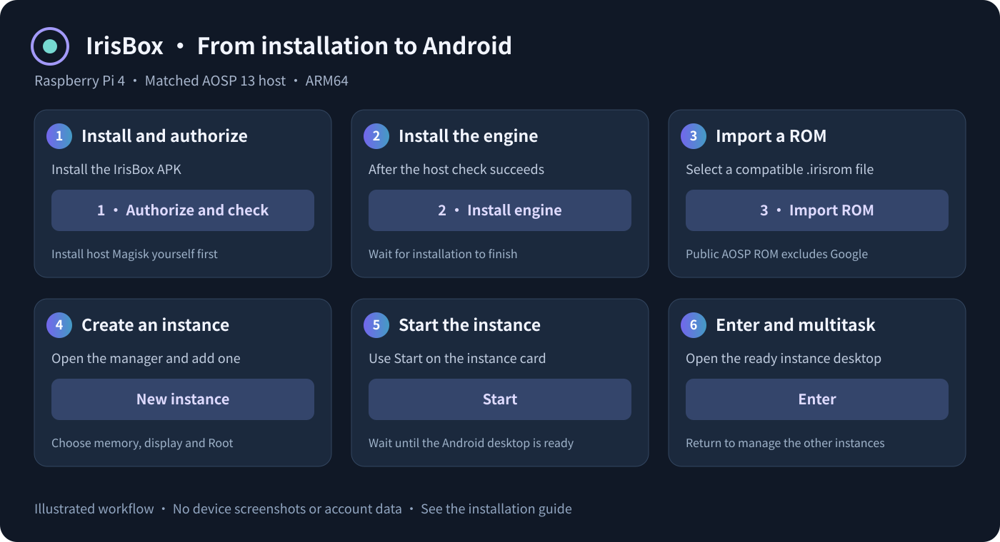
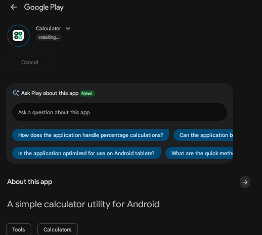
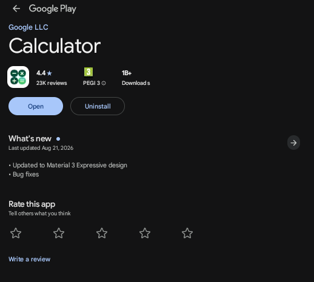
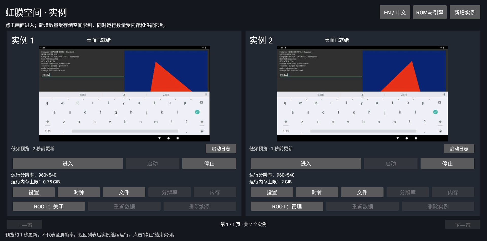
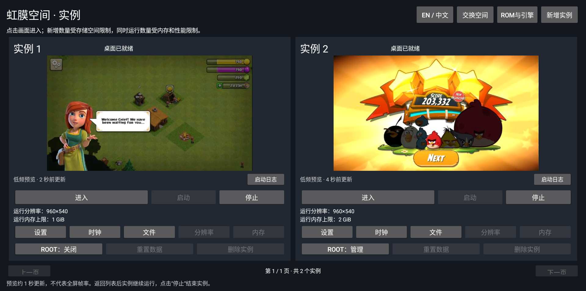
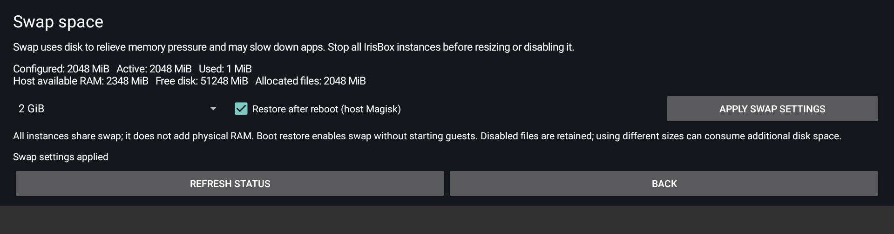

# IrisBox · Android Container

[简体中文](README.zh-CN.md) · English

IrisBox (**虹膜空间**) is a container manager that runs multiple isolated Android userspaces simultaneously on a rooted ARM64 Android host using Linux namespaces (all 7 namespaces with unprivileged User-namespace UID mapping), private BinderFS, and OverlayFS. Workflow: **Install APK → Grant host Magisk root → Install built-in engine → Import compatible ROM → Create instance → Start**.

Version **`0.3.0`** (engine **`0.3.0-e41`**) runs on a unified **ARM64 container core + declarative Board Profiles (`board.json`)** across two verified host platforms:

- **Raspberry Pi 4B (`rpi4-a13-v1`)**: Raspberry Vanilla AOSP 13 (Linux 5.15 / Mesa V3D), with a public AOSP `.irisrom` and clean USB host image preview.
- **Orange Pi 5 (`opi5-a12-v1`)**: RK3588S Android 12 (Linux 5.10 / Mali-G610), featuring enforced external NVMe/USB SSD isolation (`/data/irisbox` UUID binding + boot restoration). No proprietary/GMS ROM is redistributed for Orange Pi 5.

Instances share the host Linux kernel (no CPU emulation, no guest kernel boot). Apps, accounts, writable overlays, and configs stay isolated per instance; arbitrary phone ROMs cannot be imported.

## Get started

1. Read the [host and installation guide](docs/en/installation.md) and [release/image boundaries](docs/08_国际化与发布.md) to verify kernel support, GPU nodes, Wi-Fi, and Permissive setup (Orange Pi 5 additionally requires binding an external SSD under `/data/irisbox`).
2. **Install host Magisk yourself** per its upstream guide for your board. IrisBox never installs host Magisk or modifies host partitions/SELinux.
3. Install `IrisBox-0.3.0.apk`, tap **Authorize and check**, then **Install engine**.
4. On Raspberry Pi 4, import `IrisBox-rpi4-a13-aosp.irisrom` and create/start an instance. On Orange Pi 5, prepare a matching local ROM per [the OPi5 adaptation notes](docs/14_香橙派5内核与存储适配记录.md).
5. Use **EN / 中文** to switch System default, English, or 简体中文 for the host UI without altering guest locales or data.

[Downloads and SHA-256](DOWNLOADS.md) · [GitHub Releases](https://github.com/582835293/IrisBox/releases)

The diagram illustrates the workflow and contains no account or device data.

Existing `0.1.5`–`0.2.1` installations can upgrade the engine in place while preserving instance data via `tools/upgrade_engine.py --apply` (no repeated UID remapping needed). Earlier `0.1.4/e21` setups must first follow the stopped-state [namespace migration guide](docs/en/namespace-migration.md).

## Key capabilities & 0.3.0 highlights

- **Board decoupling (`0.2.0`+)**: `engine/boards/<profile>/board.json` + `tools/board_profiles.py` synchronize SoC parameters, Android 12/13 BPF modes, memory ceilings, and media filters from a single source. Orange Pi 5 enforces dedicated external SSD mounting (`storage_ssd.sh` + Magisk `service.d` auto-restore) to keep host internal flash clean.
- **Identity isolation & safe ROM import**: Dedicated 7-namespace isolation with disjoint non-root Host UID ranges and zero Host-UID0 fallback ([UserNS guide](docs/en/userns.md)); ROM imports verify paths, sizes, and per-file SHA-256 without executing archive scripts.
- **Dynamic uplink probing & egress control (`0.2.1`+)**: Tracks active physical uplinks (`wlan0` / `eth0`) and VPN `tun` interfaces, with per-guest direct/proxy egress and live `auto` / `domestic` / `overseas` / custom DNS switching while preserving shared eBPF `INTERNET` permission enforcement.
- **Sub-second fullscreen handoff & audio/video bridge**: Direct shared-buffer GPU output, live orientation switching, parallelized display handoff (~`0.65s–0.85s` observed on Orange Pi 5, `~0.93s` on Raspberry Pi 4), 48 kHz PCM `AudioBridge`, touch/keyboard/mouse input, and fullscreen Recents button.
- **Live Linux/Cgroup/FPS telemetry & swap protection**: Zero-fork `LinuxTelemetry` reads hierarchical memcg `total_rss`/`total_cache`/`Swap`/`majfault`, PSI, 7 namespaces, and 500ms sliding-window FPS/composition rate/Fence latency into card bars, an auto-refreshing monitor dialog, and a persistent fullscreen performance HUD. Retains 1/2/4 GiB host swap and available-RAM guardrails.
- **Cross-instance migration & safety gate (`0.3.0`)**: Host-to-guest APK installs and guest-to-guest migration (`APK` / `Android/data` / optional `/data/data` with UID/SELinux relabeling). Because migrating social session data across different container fingerprints can trigger vendor risk bans, `0.3.0` enforces an explicit typed-phrase gate before unlocking `/data/data` migration and blocks `/data/data` migration for high-risk messaging apps (WeChat / QQ / TIM / WeWork).

Public ROMs contain AOSP and compatibility overlays **without Google apps or accounts**. Optional Google support requires user-supplied matching components; guest Magisk remains per-instance and separate from host Magisk.

## Validation summary

Real-hardware verification highlights across `0.1.4`–`0.3.0` (full logs, conditions, and boundaries are in [the Chinese validation log](docs/06_验收记录.md) and [English summary](docs/en/validation.md)):

- **Raspberry Pi 4B (AOSP 13 / 3.69 GiB)**: `0.2.1-e40` in-place upgrade verified; `1010` (2048 MiB Google+Magisk) booted in `85.9s` with `eth0` connectivity, live DNS switching, `Via`/`OpenSudoku`/`Calculator`/`Magisk Manager`, and RPi4 telemetry; earlier `0.1.6` validated simultaneous Clash + Angry Birds 2, YouTube playback, and host-reboot 2 GiB swap restoration (Play device certification remains unmet).
- **Orange Pi 5 (RK3588S / Android 12)**: Enforced `114 GB` external SSD isolation + reboot auto-mount verified; dual instances, 60fps HUD, Douyin (`FPS 33.8–33.9` + AudioBridge) & Bilibili (`FPS 29.9`) playback, `3.70 GB` `1007 -> 1010` streaming migration, and the `0.3.0` `/data/data` safety-gate warning dialog passed on device.

### Early device captures (Raspberry Pi 4 archive)

| Play installation in progress | Installed from Play | Tiantian Xiangqi running |
|---|---|---|
|  |  |  |

| Clash of Clans tutorial village | YouTube video playback | Angry Birds 2 actual target destruction | Swap settings |
|---|---|---|---|
|  |  |  |  |

Above captures are early owner-approved crops/redactions with no AI redraw; newer OPi5 and RPi4 raw screenshots remain private per project rules. [Image details](docs/images/README.md).

## Documentation

| English | 简体中文 |
|---|---|
| [Architecture and isolation](docs/en/architecture.md) | [技术架构与隔离边界](docs/02_技术架构.md) |
| [Comparison and learning route](docs/en/comparison.md) | [对比与学习](docs/05_对比与学习.md) |
| [Build, maintenance and recovery](docs/en/building.md) | [构建、升级与维护](docs/04_构建与维护.md) |
| [Validation and limitations](docs/en/validation.md) | [详细验收记录](docs/06_验收记录.md)、[登录后回归](docs/07_登录后回归与修复.md) |
| [Installation and clean host image](docs/en/installation.md) | [安装与使用](docs/01_安装与使用.md)、[发布与镜像](docs/08_国际化与发布.md) |
| [User namespace isolation](docs/en/userns.md) | [User namespace 隔离与迁移](docs/09_User_namespace隔离与迁移.md) |
| [0.1.5 namespace migration](docs/en/namespace-migration.md) | [Iris 命名迁移](docs/11_Iris命名迁移.md) |
| [Swap, low memory and recovery](docs/en/low-memory.md) | [交换空间与低内存恢复](docs/12_低内存与临时交换空间.md) |
| [ROM format](docs/en/rom-format.md) | [ROM 规范](docs/03_ROM规范.md) |
| [Google Play recovery and certification](docs/en/google-recovery.md) | [Google 商店恢复与认证说明](docs/10_Google商店恢复与认证说明.md) |
| — | [网络上行探测与出口策略设计](docs/13_网络上行探测与出口策略设计.md) |
| — | [香橙派 5 内核与存储适配记录](docs/14_香橙派5内核与存储适配记录.md) |

## Preview & safety boundaries

- **Unverified flashing & fresh-host setup**: The clean RPi4 USB host image (`USB/sda`, 16 GB+, 12 GiB blank userdata, not SD/mmc) passed static checks only; **a fresh physical USB-disk flash and first boot have not been tested**, nor has initial BPF dispatcher creation on a completely clean host that never ran Project Iris.
- **Out of scope**: Arbitrary kernels/SoCs, SELinux `Enforcing`, physical camera/microphone passthrough, hardware DRM playback, Play Integrity / Google device certification, and arbitrary third-party Root modules.
- **Anti-fraud / account risk boundary**: Migrating `/data/data` transfers app state into a different container identity (`SSAID`, virtual MAC). Sensitive apps (e.g., WeChat, QQ, commercial risk-controlled clients) can impose account restrictions; rely on APK-only migration and fresh in-container logins.

See [third-party notices](THIRD_PARTY_NOTICES.md) and [source provenance](reference/NOTICE.md). Project-specific code carries no blanket license grant; keys, user data, proprietary/GMS ROMs, and raw device logs/screenshots are excluded from public distribution.
