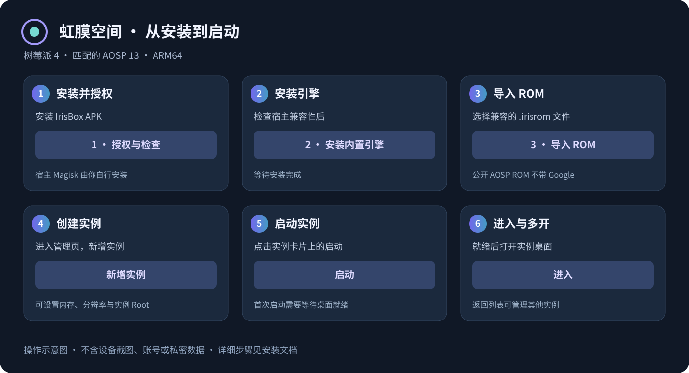
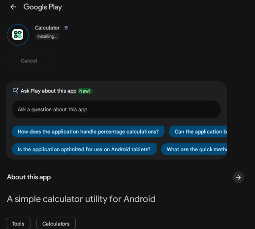
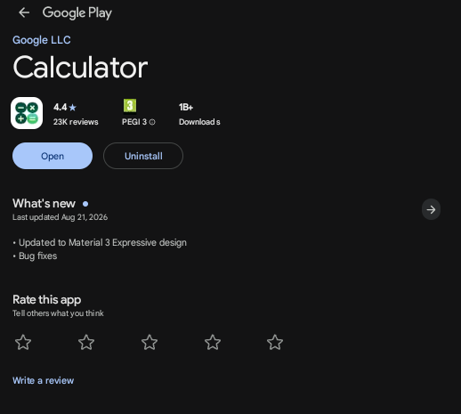
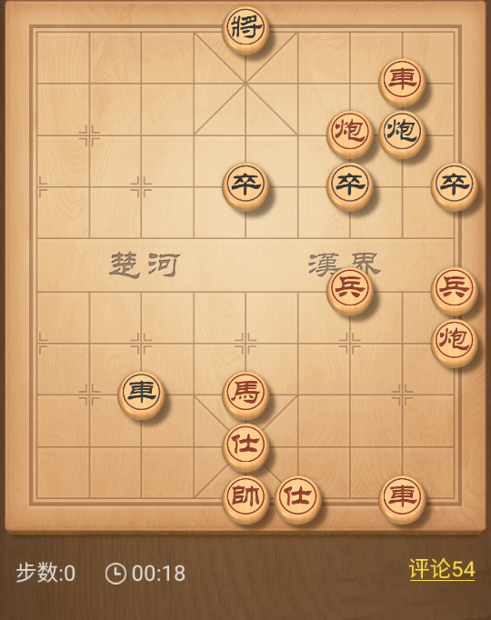
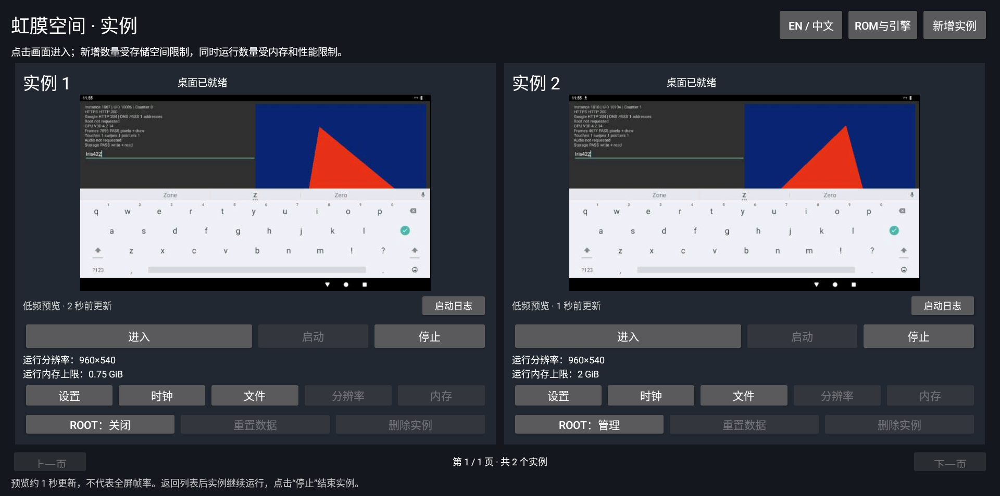
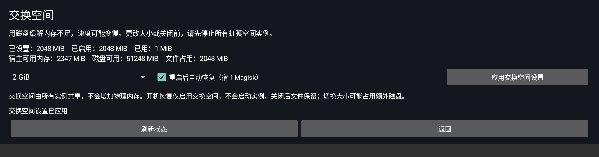

# 虹膜空间 · IrisBox

简体中文 · [English](README.md)

虹膜空间是在已获 Root 的 ARM64 Android 宿主上，基于原生 Linux 容器（7 大命名空间 + User Namespace 无特权 UID 映射 + Private BinderFS + OverlayFS）同时运行多个独立 Android 系统的虚拟化管理 App。使用流程：**安装 APK → 授予宿主 Magisk root → 安装内置引擎 → 导入兼容 ROM → 创建实例 → 启动**。

当前版本 **`0.3.2`**（引擎 **`0.3.2-e50`**）基于统一 **ARM64 容器核心 + Board Profile（`board.json`）** 架构，已验证支持两类硬件宿主平台：

- **树莓派 4B（`rpi4-a13-v1`）**：Raspberry Vanilla AOSP 13（Linux 5.15 / Mesa V3D），提供公开 AOSP ROM 与干净 USB 宿主镜像预览。
- **香橙派 5（`opi5-a12-v1`）**：RK3588S Android 12（Linux 5.10 / Mali-G610），支持外置 USB/NVMe SSD（`/data/irisbox` 独立 UUID 校验与开机恢复挂载），不附带第三方商用 ROM。

实例共享宿主 Linux 内核，不模拟 CPU、不启动独立 Guest 内核；应用、账号、写层与配置彼此隔离，不能导入任意手机刷机包。

## 快速开始

1. 阅读[安装说明](docs/01_安装与使用.md)和[发布与镜像说明](docs/08_国际化与发布.md)，确认宿主内核能力、GPU 设备节点、Wi-Fi 及已配置的 Permissive 环境（香橙派 5 需先按说明挂载外置 SSD 至 `/data/irisbox`）。
2. **宿主 Magisk 由使用者自行安装**。App 不安装宿主 Magisk，不修改宿主 SELinux 或物理分区。
3. 安装 `IrisBox-0.3.2.apk`，打开后依次点“授权与检查”“安装内置引擎”。
4. 树莓派 4 用户可点“导入 ROM”选择公开的 `IrisBox-rpi4-a13-aosp.irisrom`，然后进入管理页新增并启动实例；香橙派 5 需按[香橙派 5 适配记录](docs/14_香橙派5内核与存储适配记录.md)使用自备匹配的本地 ROM。
5. 首页支持 **EN / 中文 / 跟随系统** 切换，仅改变宿主 App 界面，不影响实例内语言或数据。

[下载与 SHA-256](DOWNLOADS.zh-CN.md) · [GitHub Releases](https://github.com/582835293/IrisBox/releases) · 从源码构建（Linux / macOS：`./build.sh`，Windows：`./build.ps1`）见[构建、升级与恢复](docs/04_构建与维护.md)

上图为操作示意，不包含设备截图、账号或私密数据。

已有 `0.1.5`～`0.2.1` 实例可通过 `tools/upgrade_engine.py --apply` 原地保数据升级引擎（无需重新映射 UID）；更早 `0.1.4/e21` 需按[Iris 命名迁移](docs/11_Iris命名迁移.md)完成停机迁移，新包名需重新授予宿主 Root。

## 核心能力与 0.3.2 演进

- **精准调优、音频热控、应用导出中文名、双向文件浏览与香橙派显示修复（`0.3.2-e43`～`e50`）**：支持单实例 CPU 亲和性 / I/O 权重 / `pids.max` / DPI / 方向 / 图形模式精准调优（`tuning.sh`）、实时音频输出开关/静音/音量调节（`AudioBridge`）、实例应用导出宿主机与跨实例清单自动解析 APK 本地化中文名（`AssetManager`/`Resources`）、支持快捷目录与子目录进入的双向文件浏览器（屏蔽 `Android/` 沙盒目录，支持 `ACTION_CREATE_DOCUMENT` 自选导出与 SHA-256 校验一键导出至 `Download/IrisBoxExport`），并修复香橙派 5 `Launcher3` 最近任务旋转与 Rockchip `persist.sys.app.rotation=force_land` 污染 `package_cache` 导致的竖屏压缩问题。

- **硬件与系统解耦（`0.2.0`+）**：通过 `engine/boards/<profile>/board.json` 与 `tools/board_profiles.py` 单源管理芯片差异、BPF 路径（Android 12/13 兼容模式）、内存护栏与媒体屏蔽规则；香橙派 5 增设 `/data/irisbox` 外置 SSD 强绑定隔离（`storage_ssd.sh` + Magisk `service.d` 重启自动挂载），避免写入内置闪存。
- **身份隔离与 ROM 安全导入**：每个实例分配独立 User / Mount / PID / Net / IPC / UTS / Cgroup 命名空间与不重叠宿主 UID 范围，无 Host-UID0 回退（[详见 UserNS 文档](docs/09_User_namespace隔离与迁移.md)）；ROM 导入校验路径、尺寸与逐文件 SHA-256，不执行打包脚本。
- **动态网络探测与出口策略（`0.2.1`+）**：支持物理上行（`wlan0` / `eth0` / VPN `tun`）动态探测切换、实例级直连或代理出口，以及 `auto` / `domestic` / `overseas` / 自定义 DNS 热切换，并保留共享 eBPF 无 `INTERNET` 权限拦截语义（[设计文档](docs/13_网络上行探测与出口策略设计.md)）。
- **低延迟全屏与音视频桥接**：DMA-BUF/Producer 共享内存直出画面与实时横竖屏切换；`0.2.1-e38` 起全屏进入路径并行化提速至亚秒级（香橙派 5 实测约 `0.65s～0.85s`，树莓派 4 实测约 `0.93s`），支持 48kHz PCM `AudioBridge` 混音、触控/键鼠输入与全屏多任务「后台」按键。
- **实时性能监控、Swap 自动清理与彻底卸载（`0.3.1`）**：内置零 fork `LinuxTelemetry` 采集宿主与单实例分层 memcg RSS/Cache/Swap/majfault、PSI、7 大命名空间状态与 500ms 滑动窗 FPS/合成帧率/Fence 延迟；Host Swap 切换档位或关闭成功后会自动销毁不再使用的旧 `swap-*.img/.record`（不碰宿主系统 zRAM）；`SetupActivity` 新增「清理并卸载」（`HostCleanup` + `uninstall_cleanup.sh`），强要求先手动停止全部实例、验签清自启脚本与 `/data/irisbox`（保留共享 eBPF 分派器）后拉起系统卸载。
- **应用跨实例迁移与高风险防护（`0.3.0`）**：支持宿主向实例安装应用以及同宿主实例间迁移（可选携带 `Android/data` / `/data/data` 与自动 UID/GID、SELinux 重映射）；针对实测中跨容器复制社交凭据易触发账号风控的情况，新增高风险 `/data/data` 迁移门禁（需输入精确确认口令解锁），并将微信/QQ 系列默认禁止携带 `/data/data` 迁入。

公开 ROM 不包含 Google 程序或任何账号；可选 Google 层须由使用者自行提供合规且与当前 profile 匹配的材料。已有私人 Google 实例维持原配置；实例内置 Magisk 与宿主 Magisk 各自独立。

## 实机验收汇总

以下为 `0.1.4`～`0.3.2` 周期内的真实双板验收概览，详尽数据与限制条款见[完整验收记录](docs/06_验收记录.md)：

- **树莓派 4B（AOSP 13 / 3.69 GiB）**：`0.2.1-e40` 原地升级保数据通过；`1010` 单开（2048 MiB Google+Magisk）85.9s 就绪，`Via`/`OpenSudoku`/`Google 计算器`/`Magisk Manager`、`eth0` 联网及 DNS 热切换通过；早期 `0.1.6` 含 `Angry Birds 2` + `部落冲突` 双游戏协同、`YouTube` 播放与真实重启 2GiB 交换空间自动恢复（Google Play 设备认证未通过）。
- **香橙派 5（RK3588S / Android 12）**：外置 `114 GB` SSD 隔离与重启自动恢复通过；无损升级直达 `0.3.2-e50`，实机通过 `20+` 款商业应用与游戏专项验证、竖屏锁定与 `Launcher3` 最近任务修复、33 款容器应用与 8 款宿主应用中文名解析、共享存储多目录浏览与路径越界拦截（HTTP `400`）及 `export_host` SHA-256 核验，以及 `host_swap` 清理、`STOP_INSTANCES` 拦截门禁、双开 60fps HUD、`AudioBridge` 与 `3.70 GB` 跨实例迁移（为保留 `32 GB` 实例数据跳过清盘卸载；`0.3.2` 未在树莓派 4B 复测）。

### 早期代表性实机画面（树莓派 4 阶段保留）

| 商店实际安装中 | 从 Play 安装完成 | 天天象棋运行 |
|---|---|---|
|  |  |  |

| 部落冲突新手村庄 | YouTube 实际视频播放 | 愤怒的小鸟2实际击碎目标 | App交换空间设置 |
|---|---|---|---|
|  |  |  |  |

以上为早期经授权裁切与隐私脱敏的实机截图，无 AI 重绘；树莓派 4 与香橙派 5 更新期原始截图及个人测试数据依项目规则仅留存私有目录，不随公开仓库分发。详见[图片说明](docs/images/README.md)。

## 文档导航

- [技术架构与隔离边界](docs/02_技术架构.md)
- [与旧项目对比及学习路线](docs/05_对比与学习.md)
- [网络上行探测与出口策略设计](docs/13_网络上行探测与出口策略设计.md)
- [香橙派 5 内核与存储适配记录](docs/14_香橙派5内核与存储适配记录.md)
- [User namespace 隔离、迁移与回退](docs/09_User_namespace隔离与迁移.md)
- [Iris 命名迁移与恢复](docs/11_Iris命名迁移.md)
- [ROM 包规范](docs/03_ROM规范.md)
- [构建、升级与恢复](docs/04_构建与维护.md)
- [交换空间设置、低内存与恢复](docs/12_低内存与临时交换空间.md)
- [详细验收记录](docs/06_验收记录.md)、[登录后回归](docs/07_登录后回归与修复.md)
- [Google 商店恢复、备份与认证区别](docs/10_Google商店恢复与认证说明.md)
- [国际化、发布及干净镜像](docs/08_国际化与发布.md)
- [English documentation](docs/en/installation.md)

## 已知边界与免责声明

- **刷机与空白宿主边界**：树莓派 4 干净宿主 USB 镜像（仅支持 USB/`sda` 16GB+ 及 12GiB 空白 userdata，非 SD 卡）仅通过文件级静态校验，**尚未在物理空白 USB 盘完成首次刷机实测**；同样未测试在从未运行过旧版参考工程的纯空白宿主上首次初始化全局 BPF 分派器。
- **未承诺能力**：不支持其他任意芯片/内核、SELinux `Enforcing`、物理摄像头/麦克风直通、硬件 DRM 受保护视频、Play Integrity / Google 设备认证与任意第三方 Root 模块。
- **迁移风控边界**：跨容器携带 `/data/data` 迁移会保持原始内部状态但处于全新容器硬件标识（`SSAID`/虚拟网卡 MAC）下，商业强风控应用（如微信、QQ、部分高频风控客户端）可能触发封号或强制下线限制，请务必遵循 UI 警告，仅使用纯 APK 安装并在新容器内独立登录。

第三方材料保留各自许可证，见[组件说明](THIRD_PARTY_NOTICES.md)与[来源记录](reference/NOTICE.md)。项目自有代码暂未授予统一开源许可证；密钥、账号、用户实例数据、含 GMS 私有 ROM 与设备原始截图/日志均不包含在公开仓库中。
