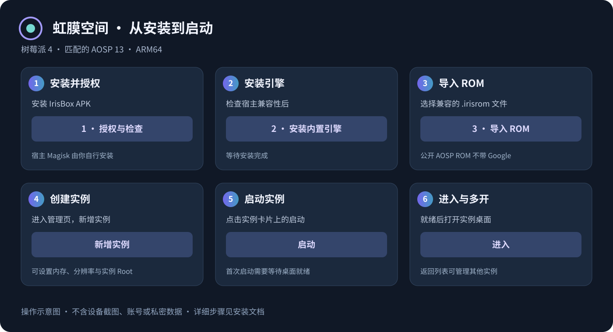
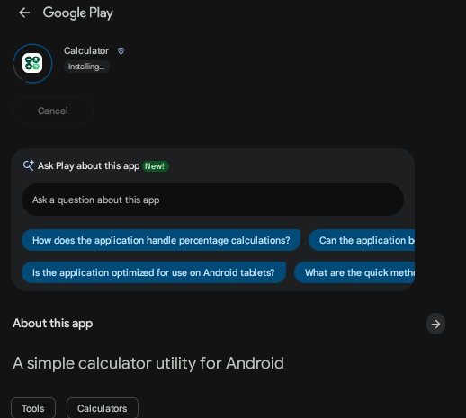
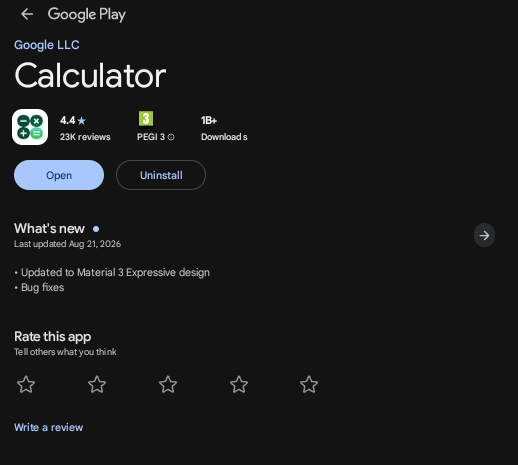
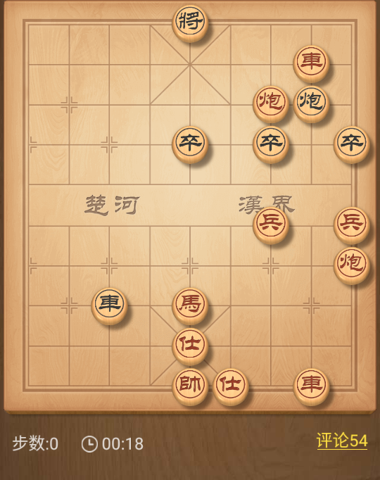
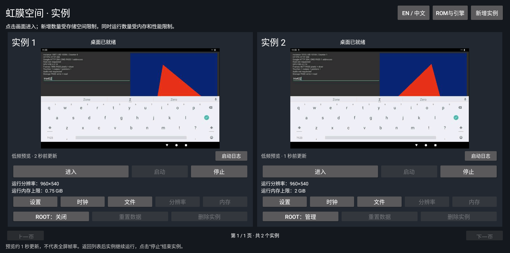
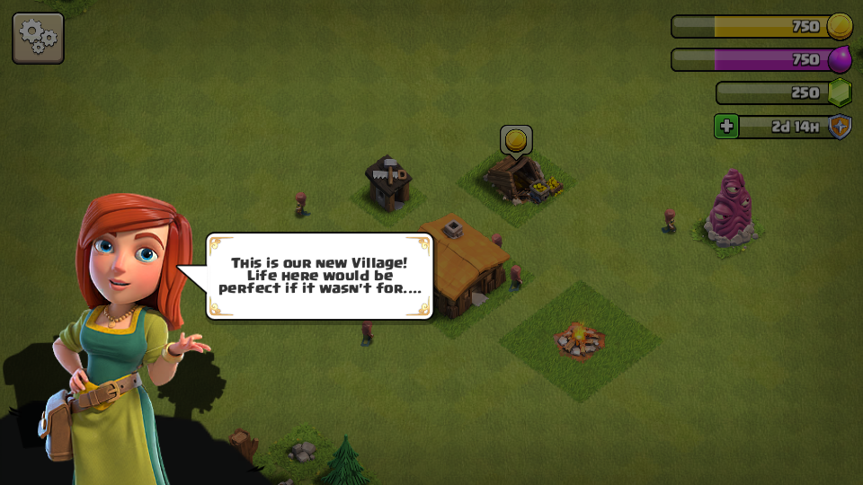
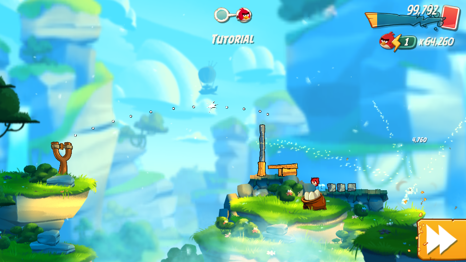
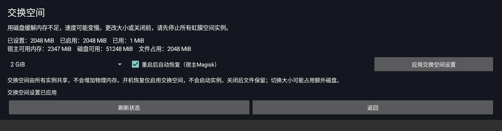

# 虹膜空间 · IrisBox

简体中文 · [English](README.md)

虹膜空间是在已获 Root 的树莓派 Android 宿主上运行多个独立 Android 实例的 App。使用流程：**安装 APK → 授予宿主 Magisk root → 安装引擎 → 导入 ROM → 创建实例 → 启动**。

当前预览版限定 **树莓派 4 / ARM64 / 已匹配的 Raspberry Vanilla AOSP 13**。实例共享宿主 Linux 内核，应用、账号、写入层及数据分别保存；不能导入任意手机刷机包。

## 安装

1. 阅读[安装说明](docs/01_安装与使用.md)和[宿主镜像说明](docs/08_国际化与发布.md)，确认指纹、内核、GPU、资源组、Wi-Fi 和已配置的 Permissive 环境。
2. **宿主 Magisk 由使用者自行安装**。App 不安装宿主 Magisk，不修改宿主 SELinux 或物理分区。
3. 安装 `IrisBox-0.1.6.apk`，打开后依次点“授权与检查”“安装内置引擎”。
4. 点“导入 ROM”，选择 `IrisBox-rpi4-a13-aosp.irisrom`；再进入管理页，新增并启动实例。
5. “EN / 中文”可以选择跟随系统、English 或简体中文。只改变本 App 的语言，不修改实例的 Android 语言、账号和数据。

[下载与 SHA-256](DOWNLOADS.zh-CN.md) · [GitHub Releases](https://github.com/582835293/IrisBox/releases)

上图为操作示意，不包含设备截图、账号或私密数据。

现有0.1.4/e21安装请先阅读 [0.1.5命名迁移与恢复](docs/11_Iris命名迁移.md)，停机备份后迁移；新包名需要正常重新授予宿主root。

## Root 身份隔离

0.1.3要求每个实例使用独立User namespace；实例root映射到专有宿主普通UID范围，没有Host UID0回退。现有e13安装需要停机备份及迁移，只更新APK还不够，见[隔离与迁移说明](docs/09_User_namespace隔离与迁移.md)。

## 能力与资料

支持独立多实例、内存上限、分辨率设置、列表预览、全屏显示、键鼠/触控输入、文件交换、实例播放声音和已测的软件视频。新增宿主交换空间设置：关闭/1/2/4GiB，可通过使用者自行安装的宿主Magisk在重启后自动恢复。实例 Root 保留现有组件及独立开关，与宿主 Magisk 授权分开。

公开 ROM 不包含 Google 程序及任何账号；可选 Google 层需要使用者自行提供有权使用、与适配清单匹配的材料。现有私人 Google 实例保持原 ROM、数据和登录，不改为公开 AOSP ROM。

已发布0.1.3的验收曾被Play Protect认证提示阻止。10月24日0.1.4实测已恢复商店目录，并从Play实际安装Open Sudoku和Google计算器；**设备认证仍未通过**，见[本轮验收](docs/06_验收记录.md)。每个实例需要使用自己的标识进行适用的自定义ROM登记，登记不等于设备认证。

**0.1.6/e27**新增App内交换空间设置并验证真实重启自动恢复，保留Iris命名、外部存储及摄像头查询修复、实时横竖屏和中英文语言设置。Angry Birds 2已在2048MiB实例、宿主2GiB交换空间条件下实际发射、击碎目标并操作Red技能，恢复原实例Magisk后也通过。YouTube播放与实例双开已通过。详见[当前验收](docs/06_验收记录.md)、[交换空间与恢复](docs/12_低内存与临时交换空间.md)和[命名迁移](docs/11_Iris命名迁移.md)。

## 实机画面

| 商店实际安装中 | 从Play安装完成 | 天天象棋运行 |
|---|---|---|
|  |  |  |

最新双游戏测试使用1024/2048MiB实例和宿主2GiB交换空间；两款均通过真实窗口交互，《愤怒的小鸟2》教程结算203,332分。属于短时教程验收，不代表长期对战或稳定帧率。部落冲突空闲断线已按原有流程重连，最终双开图取重连后画面。

| 部落冲突新手村庄 | YouTube 实际视频播放 |
|---|---|
|  |  |

| 愤怒的小鸟2实际击碎目标 | App交换空间设置 |
|---|---|
|  |  |

以上是经用户授权裁切、遮挡隐私的实机截图，没有AI重绘。天天象棋图为残局棋盘；微信及QQ扫码登录、游玩由用户另外亲测确认。早期计数桌面双开图使用768/2048MiB；最新双游戏图使用1024/2048MiB与宿主2GiB交换空间，教程交互通过，长期对战与帧率未验证。部落冲突图片为新手村庄与教程交互，不代表长期对战；YouTube为实际播放片段。这些画面不代表Google设备认证通过。见[图片说明](docs/images/README.md)。

- [0.1.5 Iris命名迁移与恢复](docs/11_Iris命名迁移.md)
- [User namespace隔离、迁移与回退](docs/09_User_namespace隔离与迁移.md)
- [技术架构与资源边界](docs/02_技术架构.md)
- [ROM 包规范](docs/03_ROM规范.md)
- [构建、升级与恢复](docs/04_构建与维护.md)
- [交换空间设置、低内存与恢复](docs/12_低内存与临时交换空间.md)
- [与旧项目对比及学习路线](docs/05_对比与学习.md)
- [首次验收](docs/06_验收记录.md)、[登录后回归](docs/07_登录后回归与修复.md)
- [Google商店恢复步骤、备份与认证区别](docs/10_Google商店恢复与认证说明.md)
- [国际化、发布及干净镜像](docs/08_国际化与发布.md)
- [English documentation](docs/en/installation.md)

干净宿主刷机镜像使用原始 boot/system/vendor 和全新空白 userdata 制作，已完成静态校验，**尚未用备用USB盘刷入并验证首次启动**。现有宿主实测不能替代从未安装旧项目的空白宿主验收。其他设备/内核、Enforcing、摄像头/麦克风、DRM、Play Integrity 和第三方模块不作通过承诺。

本项目独立维护。0.1.5使用包名 `com.irisbox.viewer` 和设备目录 `/data/irisbox`；现有安装需要按文档停机迁移。`.irisrom` 格式保持兼容，原参考工程保持只读。

第三方材料保留各自许可证，见[组件说明](THIRD_PARTY_NOTICES.md)与[来源记录](reference/NOTICE.md)。项目自有代码暂未授予统一开源许可证；公开仓库不等于更改上游许可。密钥、账号、实例数据、设备原始截图和日志不公开。

干净宿主预览镜像固定USB/sda启动，带12GiB空白userdata，适用于16GB以上USB盘；不能当作SD卡/mmc镜像使用。
