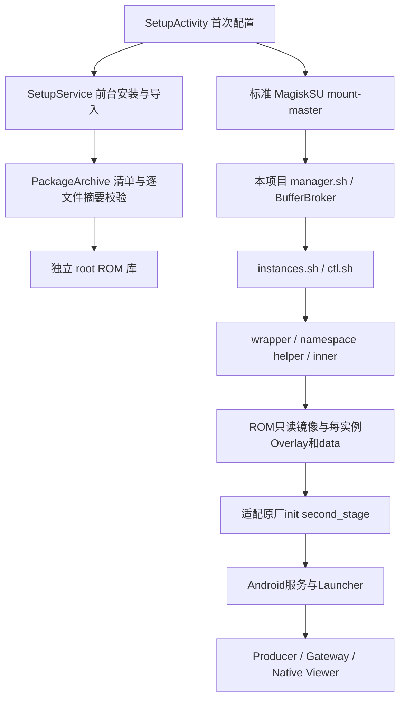

# 技术架构与隔离边界

## 调用关系

APK 是普通宿主应用，使用用户授予的 Magisk root 执行本项目的受控入口。后台使用 root app_process，在127.0.0.1:19762提供带随机令牌的管理协议。HTTP 202表示受理，最终状态由轮询和真实 Guest 会话核验确定。

ROM `system.img`/`vendor.img` 用只读 loop/ext4 挂载共享。每个实例各有 system/vendor upper/work、data、metadata、日志和配置。0.1.3起使用user/mnt/pid/net/ipc/uts/cgroup七种命名空间；实例root经UID/GID映射，不再与Host root同身份。不模拟CPU，不引导 `boot.img`。映射、受信任准备器、声音/显示降权连接及旧数据迁移见[User namespace说明](09_User_namespace隔离与迁移.md)。

private binderfs 提供实例自己的 Binder 设备；根挂载树先 make-rprivate 再 pivot_root。禁止 Guest 挂载全局 fusectl、操作物理可移动介质。继续使用旧方案中适配的原厂 init 管理服务，不恢复逐服务 Shell 点火。

## 与旧项目分开

| 资源 | 旧 Iris | IrisBox |
|---|---|---|
| 包名 | com.iris.viewer.buffer | com.irisbox.viewer |
| 设备根目录 | /data/guest/iris_runtime_v1 | /data/irisbox/runtime |
| 管理端口 | 18762 | 19762 |
| 内部实例ID | 原7、8、23等 | 1007～1134 |
| cgroup前缀 | iris_runtime_ | irisbox_ |
| Host veth | iris7h等 | rv1007h等 |
| IPv4网段 | 10.197.*等 | 172.30.(ID-1000).0/24 |
| abstract显示socket | iris_buffer_viewer_* | irisbox_viewer_* |
| 镜像及写层 | 原工程独立镜像/数据 | 新导入的独立副本/新数据 |

实例内沿用 iris_init、iris_buffer 等协议文件名，它们位于各自根目录或私有 data，不等于宿主资源冲突。镜像只读共享发生在本项目不同实例之间，新项目不借用旧项目的 lower 挂载或实例目录。

## 网络唯一共享点

Android 的根 cgroup socket-create 策略是宿主全局对象。另装一个会抢占它的分派器会影响旧项目。因此新 helper 兼容既有 `/sys/fs/bpf/iris_inet_v1` 协议：校验原程序、Host UID map、domains map、当前挂接身份，再向同一 domains 中添加新 netns cookie → 私有 UID map。Host 权限表保持不变，Guest 原厂 PermissionMonitor 维护自己的表。

旧分派器已存在但挂接身份改变时拒绝操作。新 helper 不提供 restore，登记/删除的实例ID只允许1007～1134。删除表需 cookie 与 map ID 双重匹配。新环境停止不卸载共享分派器、不移除旧 Guest 的表、不 flush 防火墙。新目录与共享对象不能笼统称为“完全没有全局状态”。

新安装的空白受支持宿主尚无分派器时，引擎按既有实现校验原厂策略并建立分派器；该空白宿主路径须另作验收，不能由本设备的共存测试推断。

## 安装与导入事务

固定脚本由已签名 APK 提供。ZIP首项必须是清单，文件名白名单、总大小、单文件大小、重复条目、未声明文件、缺项、SHA-256均核验；只创建普通文件，不执行归档命令、不接受归档的链接/权限。

ROM还需匹配ABI/API/宿主指纹/适配profile，system/vendor必须有raw ext4魔数。关键compat材料与APK内profile摘要逐项匹配。完成后复制到 root 暂存目录，再次核摘要、设置权限和标签，sync后移动为正式 ROM ID，最后更新新实例默认ROM。导入不覆盖同ID不同内容。

每实例的 `config/rom_v1/ID.id` 固定镜像版本；revision用于数据代次，session=PID:start_tick用于运行代次，两者不能互换。删除、重置和停止继续保留旧引擎的身份、锁、挂载及cgroup检查。

## 音频与视频

Guest使用ROM自带的default虚拟音频HAL；不映射宿主`/dev/snd`，也不修改宿主音频配置。`irisbox_audio`由Guest init在启动完成后管理：AudioPolicy的LOOP_BACK混合媒体等播放流，经root专用文件socket发送48kHz、16bit、双声道PCM。Host侧每实例一个AudioTrack播放，Android宿主负责混音。

socket及令牌目录0700、socket0600，服务检查peer UID和随机令牌。Host播放器和监督脚本绑定Guest的PID:start_tick；断连后清理AudioTrack并显式结束Java进程，监督脚本重新连接，Guest主会话不需要重启。该设计只输出实例播放声音，没有麦克风录音路径。接口中`audio.ready`根据当前会话、播放器身份、状态更新时间和播放进度判断，不等同于人耳已确认物理音量。

ROM适配原先禁用了`mediaextractor`，本项目在product init目录中后加载的`zzz_irisbox_media.rc`重新提供系统标准解封装服务。保留原厂mediaserver/软件codec，供MediaPlayer读取MP4。实例私有vendor配置从该ROM的原始codec清单生成，去掉不可用的V4L2 include；不向Guest映射宿主`/dev/video*`。软件codec负责实际编解码；DRM及受保护视频不由此保证。

原始ROM的Traceur依赖容器未提供的内核跟踪服务。Guest init启动前，只在已验证为private的实例挂载空间中用空tmpfs屏蔽`rootfs/system/app/Traceur`目录；不删除ROM文件或宿主APK。健康脚本只观察WindowManager就绪并记READY，不在system_server初始化时调用pm修改包，避免启动竞态。

## 官方原理参考

[Android SELinux](https://source.android.com/docs/security/features/selinux)说明强制访问控制也作用于root进程；本版显式要求已配置的Permissive。[Linux binderfs](https://docs.kernel.org/admin-guide/binderfs.html)说明不同binderfs实例的设备相互独立。[Storage Access Framework](https://developer.android.com/training/data-storage/shared/documents-files)是本项目系统文件选择与文档URI读取的依据。资料于2026-10-15核对；本项目支持范围仍以实际适配与验收为准。
