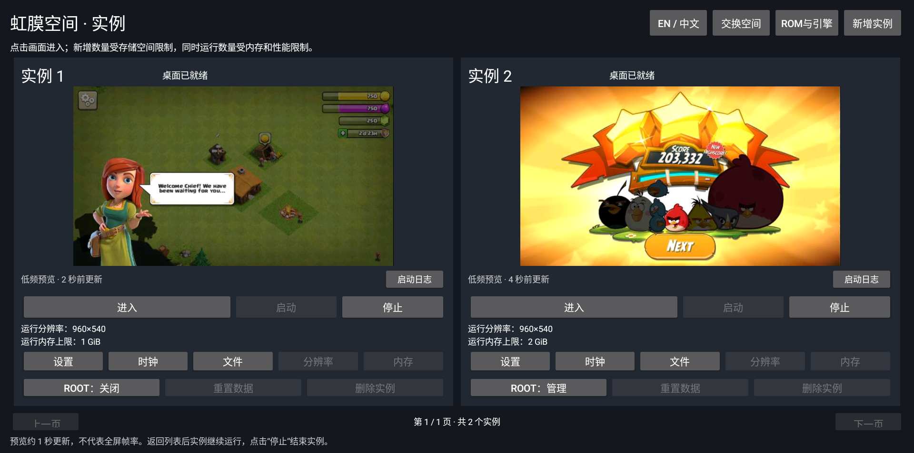

# 2026-10-15 实机验收记录

本记录区分本项目新建环境的实际结果与旧项目历史能力。设备为树莓派4 / 固定AOSP13 / 约4GiB内存。旧Iris实例7在本轮开始时运行，其余旧实例8、23没有活跃init。测试起初保留旧实例运行；随后用户明确回复“直接关闭之前的吧，也不用恢复了。暂时用不到了”，据此正常停止旧实例7及旧后台，保留数据与配置，不再恢复旧项目。没有复制旧账号或旧实例data。

## 已完成的安装与静态检查

- 独立APK包名、签名、API33目标版本；安装没有覆盖旧Iris。继承的API30目标版本曾被系统拦截，已调整为API33，通过正常安装完成，未关闭安装保护。
- App经宿主Magisk正常授权，拒绝时可见失败提示；随后通过Magisk仅开启IrisBox开关。旧Iris授权保持。
- App内宿主检查、内置引擎首次安装、系统文件选择器返回文档URI、解压/摘要校验、root ROM库提交均已实际完成。
- 生产PackageArchive在Android上执行11项测试全部通过：正常包、坏SHA、缺文件、重复项、未声明项、超出声明大小、错误profile、路径穿越、绝对路径、错误首项和超大清单。
- 本地与设备引擎39项摘要、Shell语法、116项ROM适配profile、54项Google静态文件、11项Magisk组件通过核验；e2原生助手已实际执行new-cgroup并正常退出。
- 旧本地52项当前源码输入与提取时摘要一致；关闭旧项目以前，设备旧脚本/注册表/内存/分辨率配置、活跃init PID:start_tick、Host boot_id和根socket策略在多次对照中保持一致。授权关闭以后，旧文件和身份记录继续保持，正常停止回收旧实例网络。宿主重启会重建内核对象，不以BPF数字ID不变作为重启后要求。

## 遇到并保留的失败

1. Google原始清单含特定换行字节，初次提取格式化改变了摘要。组件审计在导入前发现，恢复原始字节并重新打包；Git attributes为固定组件禁用自动文本转换，54项审计通过。
2. e1首次新实例启动在创建Guest前返回3：脚本调用irisbox_ns，包内文件仍叫iris_runtime_ns。统一二进制打包/安装名称为irisbox_ns，新增文件名与ARM64检查，升级为e2。e1本轮测试安装在停止本项目后台、确认无Guest/init/网络/挂载后归档至`/data/irisbox/qa-e1-20261015`；ROM与测试设置保留。旧Iris没有迁移或覆盖。
3. e2重新从APK安装并再次走系统文件选择器导入，同一ROM包继续校验并成功启动。
4. 512MiB的新实例冷启动触及内存限制，未进入桌面。正常停止该新实例，调至768MiB后成功；因此不能将可配置下限512MiB宣称为推荐可用内存。
5. 文件交换测试连续提交操作时曾收到423：上次HTTP下载刚结束，但后台仍在释放操作锁。测试改为有限次数等待后重试，最终逐字节及摘要对照通过；没有绕过锁。

## 运行验收

以下均为本项目e2新建实例的实测。

| 操作 | 实际结果 |
| --- | --- |
| 空白实例1007首次启动，768MiB | 桌面就绪45,771ms；全屏显示、触摸点击成功 |
| 第二个实例1008首次启动，1024MiB | 桌面就绪62,076ms；两实例同时运行、独立列表预览持续更新 |
| 普通App联网 | 两实例内Probe均为普通UID10084，HTTPS访问返回200；没有用root网络请求替代普通应用测试 |
| 独立数据与输入 | 全屏分别点击计数器到1和2，同包名应用在两个实例内保留不同数据 |
| 停止并重启1008 | 43,620ms就绪；1007的init会话不变，1008的计数2保留 |
| 文件导入/导出 | 两实例导入同名、不同内容的51字节UTF-8文件，再导出；内容及SHA-256分别完全一致 |
| 退出并重开App | 两实例init会话和计数不变，管理页重新连接成功 |
| 停止本项目后台，再由App恢复 | App自行恢复新后台；两Guest继续运行，会话和数据不变。恢复后的bootElapsedMs为0，不伪造首次计时 |
| 临时实例1009，Google及Magisk，1280MiB | 桌面就绪88,216ms；Google Play服务和商店包存在；Guest root状态READY，`/sbin/magisk -v`为`30.7:MAGISK:R` |
| 临时实例重置/删除 | 正常停止后重置改变数据revision、保留Google及root设置；删除1009成功，主实例未清空 |

### 真实宿主重启

停止全部新Guest并同步后正常重启树莓派。Host boot_id由`13a37c82-d769-436b-8c55-3751ea0691ab`变为`11e48d19-552f-4a85-bafc-5db16aa6d3a7`，宿主版本和Permissive保持。没有打开旧Iris，也没有从电脑重新部署引擎或ROM。直接打开新App进入管理页，后台自行恢复并保留两实例配置；App按钮启动1007，42,083ms进入桌面，启动1008，46,919ms进入桌面。初次测试等待上限45秒不足以覆盖后者，延长观察后就绪；产品没有报错。开发等待工具上限已调整为90秒。

两实例重启后的Probe仍为普通UID10084，计数分别保留1和2，HTTPS均返回200，列表两张预览持续更新。新联网助手`verify`通过分派器、原宿主程序和宿主map匹配校验。`compare --old-stopped --host-rebooted`通过：Host确已重启、旧Guest无活跃init、旧脚本/配置/注册表和身份记录不变。

## 交付时状态

- APK为0.1.0 / versionCode101，内置引擎0.1.0-e2，ROM ID为`rpi4-a13-20260916`，交付文件名为`rpi4-a13-google.irisrom`。
- 树莓派已安装新App并导入ROM。新实例1007与1008运行中、桌面就绪，内存上限分别768MiB与1024MiB；两者Google及Guest root开关关闭。需要可在停止后设置可选组件；临时1009已验证Google+Magisk并删除。
- 新App停留在双实例管理页，可点“进入”使用。旧Iris后台和所有旧Guest保持停止，不恢复；旧数据与电脑源码保留。
- 组件审计54/11/116/39项通过；旧本地52项当前源码输入摘要复核通过。11项导入安全测试通过。产物与来源记录见本项目文档及`out/release-manifest.json`。

## 验证边界

旧项目双Google账号、Puzzles、单开愤怒的小鸟、LSPosed等历史验收，不自动等于本项目的实测。新Google程序层完整与无需宿主Google的读取路径已验证，账号登录、Google认证、商店下载和具体游戏仍需使用者实际账号/负载验收。本轮不读取旧账号。

已做真实Host重启并从App恢复；这证明当前已配置宿主的重启恢复，不等同于一台完全空白的新宿主从未安装旧项目时的全流程验收。其他内核/驱动、Enforcing、任意ROM、自动升级/彻底卸载不在本轮通过范围。

原始截图、状态、旧保护基线和日志只保存在本地忽略的`validation/private`，不上传。最终产物摘要保存到`out/release-manifest.json`。

## 后续回归

以上是0.1.0/e2首次交付的历史记录。用户重建实例2、安装Root/Google并登录后的新增测试、修复及最新交付状态见[登录后回归与修复](07_登录后回归与修复.md)。

2026-10-15后续完成IrisBox/虹膜空间0.1.2-e13国际化及发布验收，包括真正不带Google的ROM导入/首次启动、原登录实例保留、公开源码独立完整构建与发行文件校验，详见[最终发布验收](08_国际化与发布.md)。

## 2026-10-21：0.1.3 / e17 User namespace实机回归

本节为当前新增结果，上文保留各版本当时的验收。参考旧项目2026-10-20已接入的User namespace实现，移植到独立产品范围，并处理私有0700设备目录、私有BusyBox和本项目音频桥差异。旧工程只读；本轮发现旧Guest再次运行，经用户明确授权正常停止，保留配置及数据、不恢复。

### 隔离与保留数据

两个原实例均进入桌面，仍为768MiB普通实例和1536MiB Google+Magisk实例。逐实例独立备份data/upper/vendor.upper/metadata及配置，源与备份普通文件SHA-256一致，副本使用独立inode；原ID、ROM绑定、数据revision、计数8/1和Google账号身份私有HMAC均保持。备份留在本项目maintenance目录，没有复制旧实例或宿主账号。

| 核验 | 实际结果 |
| --- | --- |
| 内核映射 | Guest root为0，Host分别为2000000000、2000100000；每域100000 UID/GID，Host UID0未映射 |
| namespace归属 | user/mnt/pid/net/ipc/uts/cgroup独立；六种非user空间的NS_GET_USERNS所有者为各自User空间 |
| 身份拒绝 | 错误PID:start_tick拒绝；Guest root能读本域0600测试文件，不能读Host UID0或另一域0600测试文件 |
| 新建公开AOSP+Root实例 | 1024MiB，86,483ms桌面就绪；无Google，普通UID网络/GPU/PCM/H.264通过 |
| 临时实例重置及删除 | 只处理自建QA实例；重置改变revision、保留映射范围，删除后保留范围分配记录 |
| 原实例首次映射启动 | 普通实例174,836ms，Google实例78,097ms；后续正常启动分别100,613ms、67,905ms |

### 功能回归

- 双开真实全屏、两个显示FD交接、键盘输入`Iris42Z`、滑动、实际“返回列表”按钮及再次进入通过；主Guest会话和原计数保持。
- 普通UID HTTPS200、Google连通性204、DNS、V3D GLES与像素检查通过；无INTERNET权限应用的HTTPS/Google端点/DNS均被拒绝。
- 两实例PCM非零、640×360/24fps H.264编码及播放渲染和播放进度通过。实例2普通App通过已保留的Magisk授权取得Guest uid0。
- 两实例分别完成同名不同内容51字节文件导入/导出及摘要对照；每实例10张640×360 JPEG预览通过。
- 缺失/错误Bearer均403。定向终止音频采集助手后21.44秒恢复，替换Host播放器和采集进程，主Guest会话不变。
- 退出重开APK及停止/恢复本项目管理后台均保持Guest会话、数据和音频。回归时Guest crash buffer无新崩溃，cgroup OOM-kill计数均0。
- 实际英文/简体中文管理页切换通过，335项资源键与Java引用一致；实例语言、会话未变，最后保留原简体中文选择。
- Android生产解包器11/11安全用例通过；Google私有输入54、Magisk11、ROM兼容116、引擎49项摘要通过。公开快照独立完整构建的49项引擎载荷逐项相同。
- 旧项目本轮基线对照通过：旧脚本、配置、注册表、身份记录、Host boot与根socket策略不变，旧Guest均停止；全局Host BusyBox摘要不变。旧项目源码参考输入摘要另有记录。

### 失败、修复与没有放宽的边界

开发候选e14在执行Guest前因Root暂存变量顺序错误拒绝，e15修正；e15的0700产品路径不能供映射身份穿越，e16采用仅私有挂载空间内的`/mnt`入口，Host目录仍0700；e16的GNU BRE可选表达式在APK BusyBox不适用，e17改为两个明确匹配，移除Guest不接管的蓝牙声明。闹钟权限、委派vmpressure、RTPRIO、显示/声音映射凭据一并按旧实现和本项目边界适配。

开发测试一次在768MiB实例全屏时额外启动UiAutomator ART进程，造成重度回收，现有内存保护正常停止Google实例；未发生OOM kill。测试改为进入全屏前读控件位置，按原配置重新启动并再次核对账号、revision和计数。没有提高内存上限或关闭保护。超长瞬时ADB按键序列触发现有32事件有界队列的取消语义，改用短混合大小写输入验收；没有扩大队列。一次H.264编码受启动负载影响超过20秒测试预算，保留失败记录，原参数单项重试与完整双实例复测均通过。

### Google商店与未验证项

本轮实际打开商店显示“This device isn’t Play Protect certified”，**商店目录/下载未通过**。迁移前后GSF ID一致，SSAID文件逐字节一致，Google账号私有HMAC保持；迁移前备份也存在未认证缓存。不能据此确定本次提示的触发原因，也不能以账号条数代替商店验收。没有清空GSF/GMS/商店数据、修改认证判断或伪造设备指纹。

用户随后确认已使用当前实例自己的GSF ID完成[Google自定义ROM官方登记](https://www.google.com/android/uncertified/)，并明确授权正常check-in同步复测。日志有check-in成功，但实际商店仍为未认证页、目录未加载。用户要求暂不继续排查，保留数据收尾；没有据此认定为服务器审核或承诺等待即可恢复。登记不等于厂商认证、Play Integrity或所有游戏可用。

本轮没有重启宿主、重刷物理介质或重新编译整个AOSP。先前版本的Host重启记录不能替代映射版本重启验收。冷刷首启、完全干净宿主的共享分派器首次安装、Enforcing、其他ROM/内核、Android多用户、任意Root模块、DRM和长期恶意负载隔离未验证。共享内核/GPU及Permissive限制仍在。中英文README新增的是使用流程示意图，未公开设备原始截图、账号或日志。

## 2026-10-24：用户重启后的启动排查及腾讯验收准备

用户报告重启后实例1无法启动。只读检查确认引擎仍为0.1.3-e17，两个实例的revision和User namespace映射登记均保持；失败命令末尾明确为内存准入拒绝，不是启动器崩溃。实例1内存被设为2560MiB，准入需要2883584KiB；旧项目实例7又在运行，占用约1.4GiB，而Host可用内存当时约1.3GiB。

按用户此前“允许停止旧项目、不用恢复”的授权，正常停止旧实例7和旧后台，保留配置及数据；经正常管理API把实例1恢复为此前验证过的768MiB。实例1在用户本次重启后的宿主上54,289ms进入桌面，原测试计数8保留，独立映射保持。没有关闭内存保护、重置实例或回退隔离。

随后为避免内存争用，暂时正常停止实例1、单独启动原Google实例2；59,305ms桌面就绪，与迁移前基线的私有账号HMAC及revision一致。商店实际可见页面仍为Play Protect未认证；启动入口短暂报告MainActivity不作为目录或下载通过依据。未清Google数据，也没有再次登记或伪造认证。

用户选定《天天象棋》用于最终腾讯游戏验收。已从腾讯官方应用宝页面核对应用宝、QQ、微信及天天象棋页面；官网给出的应用宝9.2.9安装包应为42,189,847字节。下载返回EdgeOne浏览器验证内容（含HTTP567或HTTP200的HTML），长度及APK头检查拒绝该内容，未将HTML当APK安装。电脑浏览器自动控制因无法可靠识别当前URL被工具停止，本轮不继续Windows UI操作。

**未通过/未完成：Google商店目录与下载、应用宝安装、QQ/微信登录、天天象棋授权及联网对局。** 本轮仅完成启动问题恢复和Google复测，不能把来源页存在当作应用安装或游玩验收。原始状态、日志和截图留在`validation/private/tencent-20261024`等本地忽略位置；下载准备文件留在`out/tencent-acceptance`。未修改引擎内容，没有重建APK或发布新版本。

### 同日接续：单实例验收及下载链路修复（进行中）

用户明确要求所有项目在同一个实例内实际下载、系统安装、授权及游玩，不接受电脑离线注入安装包作为验收。统一使用保留Google登录的实例2，实例1正常停止保留数据。2.5GiB配置因Host余量不足被现有保护拒绝；用户随后同意2GiB，保存并生效为2048MiB。没有关闭内存保护或停止宿主Google服务；准备时曾关闭宿主商店进程和本项目界面以尝试释放内存，未清任何数据。

实际打开实例2预装的WebView Browser Tester109，Via官网可见，但点击Android下载后下载提供器没有任务。只读检查实际Browser2 APK：71,068字节，DEX中没有DownloadListener、onDownloadStart或DownloadManager引用。原始浏览器缺少正常下载实现，不能以网站打开成功宣布可下载/安装。

0.1.4/e18新增普通实例App `com.irisbox.browser`，由可信引擎预装到私有系统写层，提供WebView、标准DownloadManager、下载列表及系统安装界面。仅声明INTERNET和REQUEST_INSTALL_PACKAGES，无Host权限/root，不静默安装，保留TLS验证。Via和应用宝等目标包仍须在实例内从官网实际下载并由系统安装；先前离线QA材料不作为通过证据。

完整构建通过，50项引擎、116项ROM兼容、11项Root和54项Google输入摘要核验通过，Host App335项国际化资源及新浏览器24项中英文资源一致。e17逐项核对后停机维护升级至e18，回退备份保留，ROM/注册表/账号/data不迁移或重置。浏览器新签名为独立私有构建密钥，公开重建时该签名资产与原构建不同，应比较未签名APK条目及其余引擎文件，不能继续笼统宣称全部载荷摘要相同。

以上为修复与部署进度；实际网页下载、系统安装、Google商店下载和游戏授权/对局结果待后续追加，不预先记通过。

### 实例内真实下载进展（同日接续）

e18对Via官网返回的`application/octet-stream`错误采用了URLUtil的`.bin`建议文件名，正常APK链接被拒绝。e19优先保留明确的URL `.apk`文件名，重新完整构建、逐项核验后维护升级，实例2的ID、revision和Google账号私有HMAC仍与原基线一致。目标APK没有从电脑注入。

- **Via下载、安装和启动通过**：实例2的普通下载浏览器从Via官网实际建立Android DownloadManager任务4，2,628,334字节、状态200；在下载列表点击，经来源授权及系统安装器安装。`mark.via` 7.3.3、普通UID10094、安装来源`com.android.packageinstaller`，首次打开及网页浏览成功。
- **应用宝下载、安装和启动通过**：在实例Via中打开腾讯应用宝官网，选择“应用宝手机版”，Via自身下载列表完成40.2MB（42,202,135字节）APK。系统提示旧目标Android版本的Play Protect兼容性拦截，经可见“Install anyway”继续，选择不上传APK；没有关闭Play Protect。Android系统安装完成，应用宝9.2.9首次启动及在线首页正常。
- **QQ下载通过、安装进行中**：在同一实例的应用宝打开QQ详情页，正常确认本次下载，实际下载约374.82MB；下载管理进入系统安装器，授予应用宝安装来源权限并点击安装。QQ启动/登录及游戏授权尚未记通过。

应用宝会请求通知权限、推荐额外软件及流量下载确认；仅处理本次所需通知/来源权限与用户指定软件，关闭9个推荐软件的一键下载弹窗。虚拟网络未作为Wi-Fi上报时应用宝提示流量确认，选择“仅本次直接下载”。2GiB上限和既有保护保持；下载后正常关闭两个闲置实例浏览器以释放安装内存，未关闭宿主Google服务。

另发现e19浏览器APK字节已更新、PackageManager仍保留1.0旧元数据；其父目录时间早于APK。e20修复可信预装阶段的目录时间刷新，以触发Android包解析缓存更新并兼容修复e19残留。e20完整构建及50/116/11/54项输入审计、335项Host资源核验通过；尚未部署/重启验证，不预先记通过。

### e20部署及内存限制的实际结果

e19停机核验后维护升级至e20，事务回退材料保留。原实例2以2048MiB启动54,398ms就绪；PackageManager正确识别浏览器versionCode2/1.0.1，APK摘要与可信引擎一致，缓存修复通过。Google账号私有HMAC、实例ID/revision和User namespace严格核验保持。公开快照独立完整构建通过：除独立私钥签名的浏览器APK外，其余49项引擎载荷逐字节一致，浏览器未签名ZIP条目也一致。

QQ包9.3.75已由系统安装并在重启后保留，安装来源为`com.android.packageinstaller`。但大型安装编译及后续首次启动分别触发Host可用内存低于512MiB的保护，不能记为QQ可正常登录/使用。日志确认正常精确会话清理、网络账本回收及数据保留，没有关闭保护。曾出现窗口局部黑色而实例原生截屏内容完整，仍需单独定位，不能用原生截图替代显示链路通过。

该Host物理内存约3.69GiB，实测SwapTotal=0。内核CONFIG_SWAP与MEMCG_SWAP开启，但没有现成zRAM设备且CONFIG_ZSMALLOC未开启；本轮没有改内核、启用交换文件、修改fstab或暂停Host Google Play服务。只正常关闭了更新APK后重新启动的宿主商店进程，账号和数据未清。

实例应用宝同时启动daemon/live/cloud等保活进程，正常force-stop后会重新拉起，日志含自身Instrumentation反复启动。临时测试标准RUN_ANY_IN_BACKGROUND限制后已恢复默认；降低安装编译并行度的`--compile-individually`/单线程仅为该运行会话的诊断设置，不是已发布的引擎行为或已证明的性能修复。用户随后明确放弃本轮QQ登录，要求直接安装天天象棋扫码：实例内QQ及应用宝暂时设为disabled-user以停止保活，APK和数据保留，可用`pm enable --user 0 包名`恢复。没有删除这些应用。

按新范围在实例Via打开腾讯天天象棋官方页面，使用页面提供的APK地址实际下载4.4.6.2，198,465,378字节；完成文件MD5与HTTPS官网元数据的99B32B44E4176F9157EA72B34A2E0758一致，另记录SHA-256。HTTPS CDN请求等待后使用官方原样HTTP下载地址，没有注入电脑APK；系统安装及扫码/对局仍待后续记录。微信、QQ登录和王者荣耀不作为本轮通过项。

随后通过Via实际下载列表进入Android系统安装器并安装完成；`com.tencent.qqgame.xq` 4.4.6.2，普通UID10097，安装来源`com.android.packageinstaller`。游戏加载进入原生登录页，自带“二维码登录→微信扫码授权/QQ扫码授权”，不要求在实例内登录QQ/微信。已实际生成微信登录二维码，交给使用者手机扫码授权。此时Host可用内存约1.2GiB、cgroup OOM-kill为0；不能把显示二维码等同于登录成功或联网对局通过。扫码和游戏结果等待使用者完成后追加。

### 使用者确认的游戏结果与e21方向功能

使用者随后确认天天象棋的微信扫码及QQ扫码均已登录并能游玩。这是使用者亲自操作确认；QQ独立App登录已取消，不记通过。实例2保持2048MiB，QQ及应用宝APK和数据保留，暂时禁用以停止保活；实例1保存的2048MiB配置保持停止，旧项目不重新启动。

本地0.1.4/e21、APK versionCode118完整构建及维护部署通过：51项引擎、116项ROM、11项Root、54项私有Google输入核验通过，343项Host中英文资源一致。实际工具栏在同一PID:start_tick切换横屏960×540、竖屏540×960，经Host窗口输入Iris9L/Iris8P正确送达Guest，GPU像素/绘制通过，原计数保持。无效模式返回400、失效session返回409，实例1方向配置不变。重启后竖屏lock1/fixed enabled保持；英文菜单及切回中文通过，最后恢复跟随应用。证据保存在私有google-orientation-20261024目录。

### Google下载恢复；严格认证验收仍未通过

正常停止Google程序后，使用Android标准缓存接口仅清GMS/商店临时缓存，再请求Google自己的正常check-in，日志有SUCCESS，商店实际目录恢复。随后从Play详情页实际下载并安装Open Sudoku4.11.1，普通UID10098，安装来源com.android.vending，可打开运行。e21升级及Guest重启后，其Play详情仍显示已安装/打开。这是下载通过，不是设备认证通过。

使用者明确要求设置页显示设备已认证。实际About仍为Device is not certified；Google自带Fix device issue返回“Couldn’t fix device certification issue”，建议更新系统。临时关闭实例Root并正常重启，确认su及magiskd不在运行后，结果相同。Root组件数据未删除。使用者提供的官方登记列表与当前GSF ID私下比对相符，号码不公开。

Google组件已在设备内私有备份，另备份商店后仅用标准pm clear重新初始化商店数据。GSF、GMS、系统账号及游戏数据未清，账号私有HMAC和GSF ID保持。商店重新同步后先显示Certification status unavailable，已使用其Check certification发起新检查；中间状态不记通过。没有修改Google APK、认证状态值、设备指纹或用本地文字代替真实结果。

[Google官方认证名单](https://storage.googleapis.com/play_public/supported_devices.html)54,261条表格行中，Raspberry/rpi4/aosp_rpi4均无匹配；当前仍为既有Raspberry AOSP13 userdebug/test-keys构建。[官方认证说明](https://support.google.com/googleplay/answer/7165974?hl=en)与[自定义ROM登记说明](https://www.google.com/android/uncertified/warningauto)区分认证和Google应用使用登记。旧项目记录证明过实际下载及重启可用，没有证明About显示已认证，不能混同。

本轮未重启宿主、修改旧工程、清除Google登录或推送GitHub。按使用者标准，认证验收仍未通过。

使用者随后明确允许重建Google Play服务数据，必要时本人重新登录。复验原版组件与数据备份后，经Android卸载更新回到预装GMS22.46.19/224619045，核对GSF ID及账号私有HMAC保持；再由标准PackageInstaller会话装回备份的11个原版APK（235,572,891字节），恢复26.39.33/263933029，保留新建服务状态，没有恢复旧CE/DE。游戏shared_prefs前后逐文件SHA-256一致。新服务日志有check-in SUCCESS，商店目录可打开；About仍显示Device is not certified，再次运行Google自带Fix device issue。不能把账号记录保持等同于全部Google授权已验证。

另用独立本地公开源码副本完整构建e21：50项非浏览器引擎载荷及浏览器未签名ZIP条目一致，公开51/116/11项输入和343项资源审计通过。原私钥、私有Google载荷和原始验收材料不在该副本中。此操作不包含GitHub推送。

收尾正常恢复实例Magisk，59,299ms就绪，普通UID测试程序已有su授权保持，严格User namespace核验通过。服务重建和本次重启后又在Play实际下载安装并打开Google计算器9.3/85022643，普通UID10101，installer=com.android.vending，无需用户重新登录。最终About真实认证行仍为Device is not certified。账号HMAC、实例revision及GSF ID保持，实例2为2048MiB/跟随应用。

用户随后明确取消暂缓发布，授权GitHub发布实机画面及资源，并授权用本地脚本裁切、遮挡隐私。README新增商店安装中/安装完成、天天象棋残局棋盘和实时缩略图的处理后截图；原图、账号、Google载荷和设备日志仍保持私有。游戏扫码登录及游玩为使用者确认，棋盘图片单独不作为联网对局证明；列表图如实显示一个停止实例和一个运行实例。中英文恢复指南见10文档及en/google-recovery.md。大资源先上传发行草稿，核验已上传附件后再填写公开链接；不虚构网盘地址。

0.1.4预览版已公开发布：独立公开源码及4张处理后实机图片已推送，发行附件含APK、AOSP ROM、干净宿主镜像/元数据、Root/BusyBox及内核源码、SHA256SUMS和资源清单，共8项。上传后逐项核对服务器大小与SHA-256，公开后再从GitHub实际返回的地址生成下载页；无需等待网盘。设备认证未通过这一限制保留在README、恢复指南、发行说明和机器可读清单中。

## 2026-10-26：0.1.5 Iris 命名迁移及应用兼容验收

按使用者明确授权，产品自身内部标识一起迁移：宿主包`com.irisbox.viewer`、设备根`/data/irisbox`、普通下载浏览器和QA包`com.irisbox.*`、原生启动器、音频服务、套接字及资源组均采用Iris命名。端口19762、实例编号、revision、UID/GID范围保持。旧包名/根从已核验旧APK读取，迁移前两个实例的data/upper/vendor.upper/metadata做独立逐文件SHA-256备份；首次事务变量冲突触发自动回退，修正专用变量及停止显示指针后迁移提交。原入口完成备份、撤销其独有旧授权并退役；新包通过正常宿主Magisk界面授权，没有复制授权数据库。原独立Project Iris只按授权正常停止，不重新启动，配置/数据保留。

### 两项实际发现并修复的问题

- YouTube启动查询摄像头数量时，因框架cameraserver被替换成true而一直等待，触发ANR。e24恢复实例内原厂框架服务；物理provider及设备保持禁用，dumpsys返回0台摄像头。修复后原版YouTube进入播放。
- User namespace未建立projid_map；补齐后仍不能改变项目配额，因为匹配内核禁止非初始User namespace修改该状态。e25在独立临时目录仅重编匹配vold的Utils并重链接；仅严格匹配实例身份跳过项目配额标签/继承，保留目录、UID/GID、模式、默认ACL及FUSE权限检查。普通应用外部目录写入/读回通过。**当前profile不提供按应用项目磁盘配额**，不以映射表存在替代功能测试。补丁/摘要/复编步骤随源码提供，宿主/AOSP/旧工程均未被覆盖。

### 应用与功能结果

| 项目 | 结果及边界 |
|---|---|
| Google Play实际下载 | 同一实例内下载、安装部落冲突、Angry Birds 2、YouTube；PackageManager来源均为com.android.vending。Google账号私有HMAC、GSF ID、实例revision保持。设备认证仍未通过。 |
| 部落冲突18.647.5 | 村庄正常渲染，使用真实虹膜空间全屏输入推进新手对话；年龄页面不公开。长期对战、部落战、支付未验证。 |
| YouTube21.42.243 | 原版应用播放Blender官方Big Buck Bunny，e25实际进度从1分35秒推进到3分2秒；全屏显示、声音有非零采样。网络缓冲曾出现，不承诺4K或DRM。 |
| Angry Birds 2 26.7.1 | Play安装及保留数据重装完成，但仍停在启动画面，日志出现资源包不可用及首次存档路径异常；**关卡/发射游玩未通过**。未把启动图当作游玩通过。 |
| 中英文设置 | 343项Host资源一致；English选择在结束并重开App后保持，恢复简体中文通过。Guest语言与会话不变。 |
| 双开 | 实例1为768MiB、实例2为2048MiB，同时桌面就绪；两个独立映射、Host UID0/其他实例测试文件读取拒绝、严格namespace归属和错误start_tick拒绝通过。真实全屏键盘/滑动/重入、无INTERNET的HTTPS/DNS拒绝、同名不同内容文件往返和独立音频通过。不是两款大型游戏同时运行验收。 |

最终0.1.5/e25完整构建包括52项引擎、116项ROM、11项Root及54项私有Google输入审计和343项语言资源。公开源码副本独立完整构建，51项非浏览器载荷相同，浏览器未签名ZIP条目相同。最终APK递归检查无退役产品命名。原始截图、日志、账号指纹及收据保持私有；公开图片仅按使用者授权做确定性裁切/遮挡，见图片说明。宿主重刷首启、全新Magisk安装、空白宿主首次分派器部署及设备认证仍不记通过。

### 2026-10-27 接续：获准的单个游戏重建及最终复验

使用者明确授权仅清除Angry Birds 2。先将该游戏CE/DE及外部状态独立打包留在设备和私有本地目录，再对com.rovio.baba执行标准pm clear；Google、其他游戏及实例数据没有清除。重开后成功创建save目录并进入Main场景，原先无进度的状态消失；随后实际提示“You are offline / Please go online to complete the update”。实例Ethernet为CONNECTED/VALIDATED，同实例YouTube、Google及普通应用联网已通过。短时仅针对本实例网卡的私有诊断确认游戏请求cloud.rovio.com；这不证明该服务全部正常或设备已认证，仍未进入关卡。没有修改游戏二进制、关闭TLS验证或伪造登录/认证。

最终e25双开再次通过严格映射、真实全屏键盘/滑动/重入、无INTERNET的HTTPS/DNS拒绝、同名文件隔离及独立音频。两个预览序列在截图后继续增加；cgroup OOM-kill均为0，但Google实例达到过2GiB上限且有触及内存上限的计数，不能承诺大型双游戏性能。实例2GSF ID、账号私有HMAC和revision最终核验保持，原独立项目脚本/配置/注册表及Host boot保持，旧实例未重启。

新包com.irisbox.probe需要自己的实例Magisk授权；通过正常Magisk Superuser界面仅打开该项后，普通UID10104的su实际返回Guest uid0，严格映射仍为Host普通UID范围。没有向授权数据库插入grant。中英文重开保存验证通过，测试后恢复中文。

0.1.5预览发行已公开：本版APK、SHA256SUMS及资源清单均完成GitHub服务器摘要核验；大型内容未变，下载页复用已公开0.1.4附件的真实地址与相同SHA-256。最终e25部落冲突因测试间歇出现过正常闲置断线；按原版Reload game重连，取消会覆盖当前进度的云端村庄载入，通过真实Viewer点击把欢迎语推进到下一句，最终图片更新为该次实测。没有把闲置断线截图当作交互通过。

补充无Root对照：正常停机切换实例Root为off，确认su和magiskd均不存在，账号指纹保持。游戏启动期间Host可用内存低于512MiB，watchdog在410秒正常结束该精确会话，cgroup OOM-kill为0。因此本次不足以排除Root对游戏的影响，不记为对照通过；已正常恢复原Magisk和2048MiB桌面。当前SwapTotal为0，未私自增加交换空间、降低保护阈值、改开机配置或暂停Host Google。可选的临时2GiB交换空间仍等待使用者明确选择。维护工具的--recover现在可独立使用；普通升级仍必须提供匹配旧APK。

## 2026-10-27：0.1.6/e27 交换空间与双游戏

新增首页/实例列表“交换空间”页，支持关闭、1/2/4GiB、实际使用/可用内存/磁盘状态以及宿主Magisk开机恢复。最终版本为0.1.6、versionCode120、e27。容量切换和关闭均要求所有新项目实例正常停止；宿主Google、swappiness、实例内存保护和512MiB宿主保护没有降低。

实机UI验证了1GiB→4GiB→关闭→2GiB自动恢复；正常重启宿主后，在没有打开App或电脑重新启用的情况下，2GiB自动恢复成功。随后在最终APK验证“已开启自动恢复→关闭”会停用文件并只移除自己的开机脚本，再启用复用原文件/inode、没有重新格式化。非法大小/参数、符号链接、同名异物开机脚本及运行中实例均正确拒绝。临时异物/链接测试件及未使用的容量测试文件已清理。

初次e26在Android mksh中遇到额外FD默认close-on-exec，设置被安全拒绝、没有建立交换文件；e27显式继承锁FD并实机通过。启动与交换空间变更共享锁；两实例就绪后锁已释放，没有被长驻子进程遗留。独立公开源码完整构建匹配52项非浏览器载荷和3项浏览器未签名条目；53/116/11/54输入及372项语言资源核验通过。最终App更新时两个运行中的Guest会话保持不变。

| 项目 | 真实结果与边界 |
|---|---|
| 双游戏条件 | 同一台4GB树莓派，宿主2GiB交换空间；实例1为1024MiB、无Google/Root，实例2为2048MiB、保留Google/Magisk。不是两个2GB实例或双高帧率全屏承诺。 |
| 部落冲突18.647.5 | 第二实例使用设备内已由Play下载的5个正版同版APK，通过其PackageManager安装；没有复制账号或存档，不冒充第二次Play下载。新手村庄加载，真实Viewer点击推进对话。空闲断线出现过，按游戏原有Reload Game正常重连；最终双开图取重连后画面。未测长期对战、部落战和支付。 |
| Angry Birds 2 26.7.1 | 与部落冲突同时运行，实际拉弓、命中、破坏目标、进入第二段、激活Red技能，最终教程结算203,332分。红叉会拒绝偏离引导线的角度；调整到绿色瞄准线后正常发射，不是输入通路故障。 |
| 连续观察 | 24次采样约146.8秒，两个实例持续就绪，最低Host MemAvailable为809104KiB（约790.1MiB），两者OOM-kill均0。预览序列均推进。观察不能代表长期稳定、所有关卡或固定帧率。 |
| 保留与隔离 | 实例2账号指纹、实例revision及两实例User namespace再次核验；没有Host UID0回退。宿主重启后旧项目仍停止、原脚本/配置/注册记录保持。 |

此前YouTube真实播放、Play内实际下载、天天象棋扫码及中英文/横竖屏记录保留各自版本和时间。Google设备认证仍没有通过验收；不改认证值、Google APK或指纹来制造通过。恢复使用、开机恢复和卸载要求见[交换空间说明](12_低内存与临时交换空间.md)。

## 2026-11-13：0.2.0/e28 板卡解耦重构与树莓派 4 零回退验证

围绕“通用 ARM64 容器引擎 + Board Profile（`engine/boards/<profile>/board.json`）+ `tools/board_profiles.py` 单源产物同步”完成了全链路解耦，消除 Shell、Native C（`irisbox_userns` / `iris_inet_policy`）、Broker 与 Viewer App 中的单板硬编码，版本升至 `0.2.0`（`versionCode=121`、`engine=0.2.0-e28`）。

| 类别 | 核验内容与真实结论 |
|---|---|
| 已通过（本地构建与审计） | `build.ps1` 完整构建成功，NDK `-static -O2 -Wall -Wextra -Werror` 编译 `iris_inet_policy`、`irisbox_ns`、`irisbox_userns` 零告警通过；`tools/board_profiles.py sync` 生成 `engine/runtime/boards/rpi4-a13-v1/`、`boards.json`、`rom-profiles/rpi4-a13-v1.json` 及 `preflight.sh` 探测块；全部 `.sh`/`.rc`/`.env` 维持 LF 换行；`tests/i18n_catalog.py`（380 条资源）与 `tests/audit_inputs.py`（54 Google / 11 Magisk / 116 ROM compat / 56 引擎文件）均 PASS。 |
| 已通过（归档安全单测） | 在树莓派 4 上通过 `tests/archive/run.ps1` 验证修改后的 `PackageArchive.java`（兼容 5 参测试入口与 8 参多板卡校验入口），`ArchiveTests` 11/11 全数通过；测试完成后已卸载 `com.irisbox.tests`。 |
| 已通过（无损升级与 Broker） | 使用 `upgrade_engine.py --from-apk out/release/IrisBox-0.1.6.apk --apply` 从 `0.1.6-e27` 原位原子升级至 `0.2.0-e28` 并保留回滚备份；安装 `out/IrisBox-0.2.0.apk`；`device.py preflight` 匹配 `支持配置：树莓派4 / ARM64 / rpi4-a13-v1`；56 项运行文件 `sha256sum` 校验通过；新版 `BufferBroker` 动态读取宿主 `board.json`，`/state` 正确返回 `minMiB=512`、`maxMiB=2560`、`defaultMiB=1280`。 |
| 已通过（实例 1007 / 1010 零回退） | 既有实例 `1007`（无 Google）就绪耗时 `58.9s`，核验 `/proc/<pid>/root/proc/cmdline` 正确动态注入 `androidboot.hardware=rpi4`，正常停机；既有实例 `1010`（Google + Magisk）就绪耗时 `70.4s`（复测 `69.4s`），核验 `UPLINK=wlan0`、`graphics.effective=opengl`、环境变量 `MESA_GLES_VERSION_OVERRIDE=3.0`；就绪后等待系统 CE 存储解锁执行 `regression.py --number 2 compare` 通过（`PASS: user instance identity, data revision and Google account identity retained`），已装应用与 Magisk `30.7` 完整保留并正常停机。 |
| 已通过（旧项目与共享 BPF） | 停机旧项目脚本/配置/注册表保持未改；`iris_inet_policy verify` 返回 `verified=35 attached=35 original=21 host_map=20 domains=51`，确认首次启动新 Guest 后安全附着共享分派器，保留原厂 `original=21` 与既有共享表不抢占。 |
| 未验证与限制 | 1. `engine/boards/opi5-a12-v1/board.json` 当前标记 `verified: false` 作为草稿模板，尚未在香橙派 5 真机验证、也未生成运行时与 APK 产物；2. `make_rom.py --board` 与 `PackageArchive` 非 `rpi4` 路线仅完成参数化与编译校验，需待香橙派 5 宿主内核/ROM/节点采集后实机验收；3. 本阶段未重启后在桌面 UI 手动逐一点按全屏预览窗口，仅通过 Broker API、`regression.py` 与 `acceptance.py` 自动化核验桌面就绪状态。 |

### 2026-11-13 接续：全屏进入软重启修复、完整自动化回归与代理实机应用验收

在树莓派 4 实机按正常交互路径从列表点击进入全屏与停机回归时，排查并修复了以下三项代码缺陷，随后重新完整构建 `0.2.0 / 0.2.0-e28` 并部署到 `/data/irisbox`：

1. **列表进入全屏触发 Host 软重启修复**：结合 AOSP 13 源码核实，系统默认 `activity_{open,close}_*` 动画中的 `<extend>` 会触发 `SurfaceAnimationRunner.edgeExtendWindow()` 请求 `1x1080` 尺寸的 `captureLayers` 缓冲，导致树莓派 Host `allocator@4.0`（`libgallium_dri.so`）崩溃重启 `surfaceflinger`。通过新增无过渡主题 `IrisNoTransitionTheme`（`app/viewer/res/values/styles.xml`）、Manifest 主题声明、`display.sh` 增加 `--activity-no-animation` 及 Viewer 四处 Activity 显式禁用过渡动画修复；实机经 3 轮按钮/预览进入与退出 `DisplayActivity` 验证均正常显示 `960x540`，Host `surfaceflinger` PID 不变、无新增 tombstone。
2. **共享 BPF 分派器停机回收误判修复**：修正 `engine/native/inet/policy.c` 中 `existing_dispatcher` 校验逻辑，允许当前附着程序匹配新分派器或已知旧 `original_fd`（`verify` 子命令仍严格要求匹配当前分派器），对未知 BPF 程序保持 `EBUSY` 拒绝。实机 `ctl.sh stop 1007`、`ensure` 与 `verify`（`verified=35 attached=35 original=21 host_map=20 domains=51`）均通过。
3. **`inner.sh` 媒体配置权限边界收敛**：将 `$BB chmod 0644 "$CODECS"` 与 `chcon` 收敛至 `if [ -n "$BOARD_REMOVE_CODEC_INCLUDES" ]` 分支内，通过 `sh -n` 语法校验与构建摘要校验（`BOARD_REMOVE_CODEC_INCLUDES=""` 的异板运行分支待后续真机验证）。

#### 完整回归与真机应用验收结果

| 测试项 | 范围与条件 | 实际结果 |
|---|---|---|
| 构建与静态审计 | 本地工程（更新 56 项引擎载荷、379 条双语资源） | `build.ps1`、`tests/audit_inputs.py`、`tests/i18n_catalog.py`（380 条）、`tests/archive/run.ps1`（11/11）全部通过。 |
| 隔离与基础通路 | 实例 `1007`（1024 MiB）+ `1010`（1280 MiB）双开 | `userns_regression.py`、`preview_regression.py`（两实例各 50 张 `640x360` 抓取无崩溃）、`file_exchange.py`、`network_denial.py`（无权限应用 HTTPS/DNS 均被拒）全部通过。 |
| 媒体与代理连通 | 宿主开启本地代理局域网监听（`7890`），实例配置网关 `http_proxy` | `tests/media_regression.py` 两实例均通过：`network: HTTP 200`、`googleNetwork: HTTP 204`、`dns: PASS 1 addresses`、`V3D 4.2.14` 渲染/像素通过、音频及 `640x360` H.264 播放渲染通过。 |
| 后台恢复与横竖屏 | 隔离验收基线 `validation/private/fix-20261113`（不覆盖原基线） | `tests/runtime_regression.py --audio-recovery`（403 拦截、音频助手强杀 `14.09s` 自动重连、双开独立音频）、`tests/fullscreen_regression.py`、`tests/orientation_regression.py`（横屏/竖屏/跟随应用及旋转输入）、`tests/recovery_regression.py`（强杀 App/重启 broker 保留会话、`iris_inet_policy verify` 与 APK SHA-256 一致）全部通过。 |
| Play 商店与下载 | 停止 `1007`，将 `1010` 恢复为 `2048 MiB` 全屏实测 | Google Play 首页、已登录账号加载正常；搜索并真实下载安装 `CPU-Z`（`com.cpuid.cpu_z`）完成（验证安装成功呈现 `Open`/`Uninstall` 后已卸载清理）。 |
| 《愤怒的小鸟 2》 | 实例 `1010`（`2048 MiB`）全屏启动 `com.rovio.baba` | 冷启动进入 ROVIO 加载并完成至主提示页（显示 `Player ID` 与版本更新弹窗），画面渲染与 `IrisBufferViewer` 帧输出正常（观察到最高 `56.8 FPS`），无 crash；未强制升级并退出，未做具体关卡游玩。 |
| 《部落冲突》 | 实例 `1010`（`2048 MiB`）全屏启动 `com.supercell.clashofclans` | 冷启动后拉取资源并顺利进入村庄主场景，弹出云端村庄存档加载确认框（`45.9~53.6 FPS`、音频正常），观察到 `34.201.2.4:9339` 长连接建立；未覆盖原进度。 |
| 在线视频播放 | 实例 `1010`（`2048 MiB`）全屏 YouTube 播放测试视频 | 在 `InternalMainActivity` 实测播放 *Big Buck Bunny*，`media_session` 处于 `STATE_PLAYING`（`1.0x`），视频画面清晰无撕裂（升至 `32.2 FPS`），宿主音频 `nonzero` 采样由 `8105776` 增至 `9797540`。 |

#### 本次发现的未验证项与架构限制

1. **未验证项**：`opi5-a12-v1` 真机及 `inner.sh` 中 `BOARD_REMOVE_CODEC_INCLUDES` 为空的运行时分支尚未实跑验证；原 `logged-in-regression` 基线因此前使用者更换过 Google 账号导致 HMAC 与历史记录差异，本次新增测试均使用独立 `IRISBOX_VALIDATION_RUN=fix-20261113` 隔离验证，未篡改原基线。
2. **网络上行与代理架构限制**：当前 `board.sh:iris_select_uplink()` 与 `network.sh` 仅在实例启动时静态按 `BOARD_UPLINK_CANDIDATES`（默认 `wlan0 eth0`）匹配路由表含 `^default ` 的接口并写死 `ip rule 12009` 与 NAT 规则。这导致两个已知限制：① 运行期间宿主切换 Wi-Fi / 有线网卡时，容器无法自动切换上行；② Android 宿主运行 VPN（`tun0`）时路由表为分片 CIDR 且规则按 UID 匹配，容器 `rv*` 流量会被 `12009` 规则直接送往 `wlan0` 绕过宿主 VPN，需额外配置网关 `http_proxy`（对非 HTTP 协议/不走系统代理的 UDP/TCP 流量无透明兜底），尚待在后续网络重构与 Viewer UI 出口设置中完善。

## 2026-11-13：0.2.1 / 0.2.1-e29 动态网络上行探测与出口策略重构验收

围绕 `docs/13_网络上行探测与出口策略设计.md` 完成全链路动态上行探测、4 种实例级出口策略（`follow_host_uplink` / `host_vpn_tun` / `host_proxy` / `fixed_uplink`）、无网先启动（`uplink=none`）+ `3s` Broker / `5s` Watchdog 热切换、孤儿数字策略表清扫（`prune_orphan_out_rules`）及 Viewer UI 控制弹窗与双语同步，版本升至 `0.2.1`（`versionCode=122`、`engine=0.2.1-e29`），部署到树莓派 4 实机验证完毕。

| 类别 | 核验范围与条件 | 实际结果 |
|---|---|---|
| 构建与静态审计 | 本地工程及 RPi4 单测 | `build.ps1` 完整构建通过：`out/IrisBox-0.2.1.apk`（`18,015,107` 字节，SHA-256 `a9ad21dda4502c93c78e923da4cbb95d77b393d3ac4a15100b14eb717b932823`）、56 项 `engine.zip`（`15,413,775` 字节，SHA-256 `4d581643e7f321dab8451d6f1250d195f3c001ae9e6f63861e3a1582e2720423`）；`tests/audit_inputs.py`（54 Google / 11 Magisk / 116 ROM compat / 56 引擎匹配）、`tests/i18n_catalog.py`（416 条双语资源）与 `tests/archive/run.ps1`（11/11）全数通过；`device.py preflight` 与 `network.sh host-probe` 正确识别 `wlan0` / `tun0`。 |
| 出口策略 UI 与即时探测 | Viewer `ListActivity` UI（`uiautomator` 与截图） | 卡片列表准确显示 `网络出口：自动（wlan0）` / `网络出口：VPN 隧道（tun0）`；“网络出口”弹窗展示宿主当前网卡与 VPN 状态、4 种策略单选、端口与网卡快捷填充、VPN 断线 `fail_closed` 开关；点击不关闭弹窗的“测试当前出口”后 `follow_host_uplink -> wlan0` 实测回显 `HTTP/1.1 204 No Content`。 |
| VPN 透明出口与断连防泄露 | 实例 `1010` 配合 FlClash（`tun0`）启停切换 | `host_vpn_tun -> tun0` 下 `com.irisbox.probe`（`HTTP 200` / `204` / `DNS PASS 1 addresses`）、`com.irisbox.noinet`（3 项权限拦截）及 YouTube 播放均正常；断开 VPN 时 `fallback_physical` 自动切换 `wlan0`，切换 `fail_closed` 后 `prune_orphan_out_rules` 彻底清除 `tun0` 销毁遗留的纯数字路由表孤儿规则（剩余 `ip rule` 为空）且 `test-egress` 即时返回阻断提示不卡死；重连 VPN 自动恢复 `tun0` 及 `HTTP/1.1 204`。 |
| 宿主代理自动配置与回收 | 实例 `1010` 切换 `host_proxy:7890` 与切出 | 启用 `host_proxy` 后自动放行 Host `INPUT`（`IRISBOX_NET_1010_*_PROXY_IN`）并注入 Guest `http_proxy=172.30.10.1:7890`、`global_http_proxy_{host,port}`，`test-egress` 返回 `网关代理可达: PASS` 与 `HTTP/1.1 204`；切换至缺失网卡 `fixed_uplink:eth0` 后进入 `effectiveUplink=none` 并自动回收 Host `INPUT` / `ip rule` 与全部 Guest 代理键（恢复 `null`）；切回 `fixed_uplink:wlan0` 恢复连通。 |
| 媒体与网络权限回归 | 双实例（`1007` + `1010`）并发测试 | `tests/media_regression.py --numbers 1 2` 在两实例 `host_vpn_tun -> tun0` 模式下全部通过（HTTP 200/204、DNS PASS、`V3D` 像素与绘图、音频 `PLAYING`、`640x360` H.264 播放）；随后切回默认 `follow_host_uplink -> wlan0` 复测 `tests/network_denial.py` 两实例（`10087`/`10091`）全数拦截通过。 |
| 完整自动化回归 | 独立基线 `IRISBOX_VALIDATION_RUN=net-20261113`（默认 `follow_host_uplink -> wlan0`） | `tests/fullscreen_regression.py`（双实例全屏输入/手势/重入）、`tests/orientation_regression.py`（横竖屏 `[960,540]` / `[540,960]`、旋转输入、GPU 与 400/409 守卫）、`tests/runtime_regression.py --audio-recovery`（403 鉴权、强杀音频 `15.06s` 重连 `1034 -> 7210`、`nonzero=31906`、双开独立音频）与 `tests/recovery_regression.py`（强杀 App/重启 Broker 会话保留、`guestBootCrashes: 0`、Traceur 隔离、APK SHA-256 一致）全部 PASS，且全程 `compare()` 校验实例身份与 Google 账号 HMAC 一致无损坏。 |

### 未验证与已知约束（`0.2.1 / 0.2.1-e29`）

1. **双物理网卡实拔测试待补**：当前树莓派 4 实验环境仅接入 `wlan0`（`eth0` 未插网线），`wlan0 <-> eth0` 双物理网卡实时插拔热切换尚未真机实跑，等效切换与离线自愈状态机已由 `fixed_uplink:eth0/wlan0` 及 `tun0` 断连恢复验证。
2. **网络条件声明**：`tests/media_regression.py` 因包含 Google 204 与海外 DNS 探测，在两实例设为 `host_vpn_tun`（`tun0`）下执行通过；其余全套全屏、横竖屏、运行时音频恢复、恢复及无权限拦截回归均在默认直连 `follow_host_uplink -> wlan0` 下执行通过。
3. **`opi5-a12-v1` 未真机验证**：`opi5-a12-v1` 板卡配置仍维持草稿状态未真机测试，与本轮树莓派 4 改动相互独立。

## 2026-11-16：v2 阶段 2 完成——香橙派 5（RK3588S / Android 12）内核、Magisk 与外置 SSD 全链路验收

围绕 16GB Orange Pi 5（`ro.product.device=rk3588s_s`、Android 12 / SDK `32`、内核 `5.10.160`）完成定制内核刷机、宿主 Magisk v30.7 安装与环境补全、128GB USB 3.0 SSD（`ext4`）`/data/irisbox` 绑定/写拦截/安全卸载/开机自动挂载恢复、`opi5-a12-v1` Profile 转正、`preflight` 与内置引擎 `0.2.1-e29` 安装验收；详见 [香橙派 5 内核与存储适配记录](14_香橙派5内核与存储适配记录.md)。

| 类别 | 核验范围与条件 | 实际结果 |
|---|---|---|
| 外置 SSD 格式化 | `/dev/block/sda1`（128GB USB 3.0 SSD） | 从 `vold` 卸载 exFAT 后以 `mkfs.ext4 -F -L irisbox_ssd -O ^metadata_csum` 格式化完成（`UUID=17513715-74ee-4a53-9cb9-568e3524c61f`），`e2fsck -fy` 通过；`vold` 自动维持其 `unmounted`。 |
| Android 12 BPF 探针与网络策略 | `a12_bpf_probe` 与 `iris_inet_policy inspect` | `/sys/fs/cgroup` 上 `BPF_PROG_QUERY` 返回 `prog_cnt=1`、`id=27`；引擎安装后实跑 `iris_inet_policy inspect`（`a12-legacy-single` + 自编译 `SO_NETNS_COOKIE=71`）返回 `attached=27 host_map=36 type=1 key=4 value=1 max=2000 flags=0 cookie=1`。 |
| 定制 5.10.160 内核编译与修复 | 基于 `orange-pi-5.10-rk35xx` 与 `clang-r450784d` | 补齐 `USER_NS`/`PID_NS`/`POSIX_MQUEUE`/`IPC_NS`/`CGROUP_PIDS`/`CFS_BANDWIDTH` 与 `SO_NETNS_COOKIE=71`；内置 `8821cu`/`r8168`/`fuxi`/`rtk_btusb` 规避 `MODVERSIONS` CRC 变化（`0x55a12ad9 -> 0xdba2b9d3`）；通过 `1500000` 波特率串口修复 `dw-hdmi-qp.c` 缺 `hdcp14_mem` 空指针崩溃及 `firmware_loader/main.c` `/vendor/etc/firmware` 回落路径；7 层 Namespace、`unshare`、cgroup、overlay 参数全 `N` 与 `/dev/mali0` 全通过。 |
| 宿主 Magisk v30.7 部署 | 官方 `Magisk-v30.7.apk`（SHA-256 `e0d32d2123532860f97123d927b1bb86c4e08e6fd8a48bfc6b5bee0afae9ebd5`） | `boot_patch.sh`（`KEEPVERITY=true`、`KEEPFORCEENCRYPT=true`、`PREINITDEVICE=cache`）生成 `opi5_irisbox_magisk_boot.img`（SHA-256 `c3621212d5a0f1a2463b7aae17596bd0b37348a7fb083152fc98d297b122cf41`）写入 `boot`；补齐 `/data/adb/magisk/` 官方组件后重启，`env_check 30.7 30700` 返回 `0`，Magisk App 显示 `30.7 (30700)`，永久授权、`超级用户` 与 `service.d` 正常生效。 |
| 外置 SSD 写前拦截与挂载恢复 | `HostStorage`、`storage_ssd.sh` 与 `adb reboot` 实测 | 未挂载或安全卸载后，点击 `1 · 授权与检查` / `4 · 管理实例` 准确拦截报错 `外置 SSD 未挂载至 /data/irisbox，已拦截写入内部存储`，内部 `/data/irisbox` 保持空目录；绑定挂载后 `/data`（dev `64775`）与 `/data/irisbox`（dev `2049`）隔离；`adb reboot` 重启后 `/data/adb/service.d/irisbox-storage.sh` 通过 `nsenter -t 1 -m` 自动完成 `e2fsck -p`（clean）与挂载并核验标记文件，首页直接恢复 `引擎：0.2.1-e29`。 |
| `preflight`、引擎安装与工程单测 | 构建 `out/IrisBox-0.2.1.apk`（`0.2.1-e29`）并实机运行 | `SetupActivity` `preflight` 全绿（`支持配置：香橙派5 / ARM64 / opi5-a12-v1`）；58 个引擎文件安装到 SSD 且 `sha256sum -c files.sha256` 0 失败；`board.sh` 已修复 `mksh` 多值 `|` 死循环；`tests/archive/run.ps1 -Serial DEVICE_SERIAL` 实机 `11/11` 通过；`board_profiles.py sync`、`tests/i18n_catalog.py`（456 条）与 `tests/audit_inputs.py`（54/11/116/58）全部 PASS。 |

### 当前未验证项与限制（阶段 3/4 待接续）

1. **Guest ROM 与阶段 3/4 尚未实测**：`rom/profiles/opi5-a12-v1/compat` 与 OPi5 专用 `.irisrom` 尚未构建（`assets/rom-profiles/` 当前仅含 `rpi4-a13-v1.json`），Mali-G610 Gralloc/HWC 渲染验证、实例创建启动及《王者荣耀》测试均待阶段 3/4 实施；依赖已运行实例的 `tests/*_regression.py` 套件本次未在 OPi5 执行（树莓派 4 侧亦未针对本轮小幅改动复跑全套多实例回归，后续合并前或阶段 3 联调时复测）。
2. **宿主运维与网络限制**：设备记忆多个 Wi-Fi 时重启后可能连接至其他热点，且部分冷启动后需经由 3-pin 串口重设 `service.adb.tcp.port 5555` 并重启 `adbd` 才能从无线端接入调试。

## 2026-11-17：v2 阶段 3 完成——香橙派 5（RK3588S / Android 12）Guest 启动、显示、网络与音频全链路验收

基于阶段 2 的定制内核与外置 SSD 存储环境，完成了 OPi5 AOSP 12（API 32）Guest `1007` 从容器拉起至桌面及核心子系统的完整适配与真机验收，重新同步板卡摘要、构建 `out/IrisBox-0.2.1.apk` 与 `out/opi5-a12.irisrom`（`955,329,235` 字节，SHA-256 `70bf9df47bd135301468ad401474c60e38b6d8faec5d92ef46133f36fd8d86a8`），并在实机对齐全部运行文件与 compat 二进制的 SHA-256 校验。

### 已排查并落库的关键工程修复

1. **`memcg` 层次标志与 Linux 5.10 挂载回退**：
   - `engine/runtime/prepare_groups.sh`：修复 OPi5 `/dev/memcg` 默认 `memory.use_hierarchy=0` 且建好 `managed/` 后禁止再写入的内核限制，改为在建 `managed/` 前确保 `memory.use_hierarchy=1`。
   - `engine/native/userns/irisbox_userns.c`：针对 Linux `5.10.160` 缺少 `mount_setattr(2)`（返回 `ENOSYS`）的问题，新增 `seal_mount_readonly()`，先尝试 `__NR_mount_setattr`，`ENOSYS` 时回退到 `MS_BIND | MS_REMOUNT | MS_RDONLY | MS_NOSUID`。
2. **`iris_init` 引导链接与 `fstab` / 输入目录适配**：
   - `rom/profiles/opi5-a12-v1/compat/iris_init`：按 `/system/bin/bootstrap/linker64` 动态链接器重链接并剥离冗余符号，确保 `APEX` 激活前完成二阶段初始化与服务解析。
   - `engine/runtime/inner.sh`：使用 BusyBox `awk` 清理 `fstab.rk30board` 中的 `voldmanaged=`、动态分区 `logical` 行、`zram`、`/boot|/misc|/cache|/metadata` 及 `/data` 加密/checkpoint 选项，消除 `vold` 探测 `/dev/device-mapper` 崩溃；补齐 `/dev/input` 目录并标记 `u:object_r:input_device:s0` 避免 A12 `EventHub` 中止。
3. **Mali-G610 零硬件依赖虚拟 HWC2 与 VINTF 裁撤**：
   - 新增 `reference/src/opi5-a12/hwcomposer_iris.c` 编译产物 `rom/profiles/opi5-a12-v1/compat/payload/hwcomposer.iris.so`（纯虚拟 1920x1080@60Hz HWC2，支持 Virtual Display 与 Fence 同步），在 `compat/guest_vendor.rc` 设置 `ro.hardware.hwcomposer iris` 并由 `inner.sh` 注入至 `/vendor/lib64/hw/hwcomposer.iris.so`；放行 `vendor.hwcomposer-2-1`、`vendor.power-aidl-rockchip`、`vendor.light-rockchip`、`vendor.sensors-hal-1-0` 及 `vendor.outputmanager-1-0`（复用原厂 `hw_output.default.so` 注册 `IRkOutputManager/default` 不再阻塞 `system_server`）。
   - `engine/runtime/inner.sh`：在私有 overlay 写层中移除已被 `zz_disable_vendor.rc` 禁用的硬件/OP-TEE 服务对应 `/vendor/etc/vintf/manifest/*.xml` 片段（`gatekeeper@1.0`、`weaver@1.0`、`media.c2@1.1`、`widevine`、`cas`、`wifi`、`rknn`、`rockit`、`usb@1.0`），避免 `HidlServiceManagement::getService()` 无限等待。
4. **A12 `libgui` 帧采集重编译、Mali `stride=0` 放行与以太网权限补全**：
   - 为 OPi5 A12 重编译 `compat/payload/iris_buffer_producer`（适配 `android::DisplayCaptureArgs` 与 `uint32_t ui::LayerStack`，`engine/native/buffer/buffer_producer.cpp` 同步保留 `IRIS_AOSP_12` 条件编译；`inner.sh` 与 `engine/native/userns/userns_display.h` 按实例绑定 ROM 优先选用 `compat/payload/iris_buffer_producer`；`EngineInstaller.java` 与 `tools/make_rom.py` 纳入该文件权限与校验）。
   - `app/viewer/native/buffer_viewer.cpp`：ARM Mali-G610 Bifrost `gralloc4` 对 AFBC/非锁定 GPU 共享缓冲将 `AHardwareBuffer` 包头与描述符中的 `stride` 上报为 `0`，修改 `preflightAHB()` 与导入后描述符校验允许 `stride == 0`。
   - `engine/runtime/inner.sh`：在裁撤物理 `android.hardware.usb.host.xml` 后自动补齐 `/vendor/etc/permissions/android.hardware.ethernet.xml`，使 A12 `SystemServer` 正常拉起 `EthernetService` 管理容器 `eth0`。

### 真机与离线验证结果

| 类别 | 核验范围与条件 | 实际结果 |
|---|---|---|
| 本地构建与静态审计 | 全部源码与板卡配置同步后 | `tools/board_profiles.py sync` 同步 `opi5-a12-v1` / `rpi4-a13-v1`；`.\build.ps1` 构建成功（`out/IrisBox-0.2.1.apk` SHA-256 `1455c77232651492352dd6f2e123ec644ab7f6ee62ae62f4e7c95530ee24f1f3`，`engine.zip` 58 项文件 SHA-256 `6d81084ccb2bb82919f93af1fdb82c6bcf9553ff66fb795df09b7230038bf009`）；`tests/i18n_catalog.py`（456 条）与 `tests/audit_inputs.py`（54 Google / 11 Magisk / 116 ROM compat / 58 引擎）全部 PASS；`tools/make_rom.py --board opi5-a12-v1` 重打包 `out/opi5-a12.irisrom`（123 文件）通过。 |
| Guest `1007` 完整引导与桌面 | 2048 MiB 默认配额，`960x540` | 安装最终 APK 并核验 `prepare_groups.sh`、`inner.sh`、`irisbox_userns`、`guest_vendor.rc`、`zz_disable_vendor.rc`、`iris_buffer_producer`、`hwcomposer.iris.so`、`iris_init` 设备侧 SHA-256 一致后启动，`BOOT=1` 就绪，`com.android.systemui`、`com.android.launcher3`、`keystore2`、`IKeyMintDevice/default`、`vold` 均正常运行。 |
| 预览与全屏 DMA-BUF 共享渲染 + 触控 | `ListActivity` 预览及 `DisplayActivity`（Mali-G610） | 列表实时抓取 `640x360` 桌面缩略图；点击进入 `DisplayActivity` 进入 `ACTIVE`，`IRIS_BUFFER_IMPORT` 确认通过 `SEQPACKET` 零拷贝导入 `/dmabuf:...-allocator@4.0-s`（`960x540` `stride=0` `format=1`）并完成事务渲染与 fence 同步；真机滑动打开 Guest 应用抽屉及点击启动 `Settings` 成功，点按“返回列表”正常停止显示并保留 Guest 会话。 |
| 网络隔离、DNS/TCP 与音频桥接 | 默认 `follow_host_uplink -> wlan0` + `iris_inet` BPF | `/sys/fs/bpf/iris_inet_v1/guest_1007_*` 生效，Guest `eth0` 通过 `udhcpd` 获取 `172.30.7.2/24 -> 172.30.7.1`；实测 `ping 223.5.5.5`、`ping baidu.com` 解析与 `toybox nc` 访问 `baidu.com:80` 返回 `HTTP/1.0 301`；`AudioBridge` 双向进程就绪，`audio/host.status` 记录到真实非零 PCM 传输（`nonzero=8790`、`peak=2940`）。 |

### 未验证项与已知边界（阶段 4 待接续）

1. **全新清空 `/data/irisbox` 从零重导入实测未补跑**：本轮最终一致性验收是在保留阶段 2 已导入 `opi5-a12-v1-rom` 基础上原地安装新版 APK、更新运行时及 `compat` 并核对 SHA-256 一致后完成重启验证；新打包的 `out/opi5-a12.irisrom` 从空白 `/data/irisbox` 走完 `SetupActivity -> 文档选择器导入 -> 创建并启动 1007` 全流程及 `tests/archive/run.ps1` 在最新 APK 上尚未单独复跑。
2. **多开并发与阶段 4 应用/游戏**：OPi5 上双实例并发启动、`Google` 核心套件（需 `--with-google` ROM）、`tests/*_regression.py` 自动化套件与目标手游（如《王者荣耀》帧率/操控）尚未在本阶段测试；树莓派 4 侧亦未针对本轮少量跨板公共改动复跑全套回归。
3. **系统安全边界**：宿主 SELinux 仍保持 Permissive，共享内核与 `/dev/mali0` GPU 的固有容器边界不变。

## 2026-11-17：`0.2.1-e30` 阶段 3.5 产品增强（动态物理内存、4 GiB 文件交换、宿主应用直迁）

在进入阶段 4 应用与游戏实测前，围绕 OPi5 16 GB 硬件能力与使用流程完成 3 项架构级产品增强，并将内置引擎版本由 `0.2.1-e29` 递增至 `0.2.1-e30`：

1. **动态物理内存配额上限（替换原 4 GB 树莓派硬编码限制）**：
   - `engine/boards/opi5-a12-v1/board.json` 将默认配额调整为 `4096 MiB`（`4 GiB`）、板卡基准上限调整为 `12288 MiB`（`12 GiB`）。
   - `engine/runtime/board.sh`（`_iris_apply_dynamic_memory()`）与 `app/broker/src/com/iris/buffer/viewer/broker/BufferBroker.java`（`boardMemorySpec()`）统一从 `/proc/meminfo` 读取实时 `MemTotal` 计算动态可调区间与默认值；`ListActivity.java` 内存弹出框新增显示宿主物理内存总额（实测显示 `15.323 GiB`）与板卡默认提示，同时保持 4 GB 树莓派安全上限 `2560 MiB`。
2. **`4 GiB` / `30 分钟` 文件交换与开源重构 `guest.jar`**：
   - 新增开源工程 `app/file-exchange/`（`GuestExchange.java` 与 `build.ps1`）并接入主构建脚本 `build.ps1`，彻底替代原先硬编码 `128 MiB` 与 `120s` 的预编译 `guest.jar`。
   - 同步更新 `ExchangeProtocol.java`、`ExchangeFiles.java`、`TransferIO.java` 与 `FileActivity.java`，将单文件传输上限放宽至 `4 GiB`（`4294967296` 字节）、传输超时放宽至 `1800` 秒（Broker 助手进程超时同步放宽至 `1810` 秒）。
3. **宿主已安装应用与 OBB 数据包直接迁入容器**：
   - `app/viewer/AndroidManifest.xml` 增加 `QUERY_ALL_PACKAGES` 以解析宿主第三方应用显示名称与版本信息。
   - 新增 `app/broker/.../HostAppImporter.java` 并在 `BufferBroker.java` 暴露 `GET /apps/host`、`POST /apps/import` 与 `GET /apps/import/status`，支持识别多 Split APK 与 `/data/media/0/Android/obb/<pkg>/*.obb` 数据包，通过 `pm install-create / install-write / install-commit` 分片清理式原子安装并配置 `1023:1023` OBB 权限与 SELinux 上下文恢复；`ListActivity.java` 新增“导应用”按钮、应用选择列表与实时进度弹窗。

| 类别 | 核验范围与条件 | 实际结果 |
|---|---|---|
| OPi5 USB 3.0 SSD 与宿主内存实测 | `/dev/block/sda1` 与 `/proc/meminfo` | 确认 `HP Portable SSD P500 120GB`（`090c:3282`）运行在 `xhci-hcd` `usb6` `5000 Mbps` USB 3.0 总线上，128 MiB 顺序读 `196.7 MB/s`、fsync 写 `13.9 MB/s`；宿主机 `MemTotal=16068352 kB`（`15691 MiB`）。 |
| 构建与静态审计（`0.2.1-e30`） | `build.ps1` 与离线检查脚本 | `.\build.ps1` 构建通过：`out/IrisBox-0.2.1.apk`（`18,064,408` 字节，SHA-256 `e5fb9610508e513f44aa9bacb488bd302c1ca3f11c5313ddfcbdf491041b4f14`），`engine.zip`（58 文件，`15,426,326` 字节，SHA-256 `5db871bd6c8d726f6acec270622c4bc5c9b4b074902dd82ed7effa59592f0abf`）；`tests/i18n_catalog.py`（476 条）与 `tests/audit_inputs.py`（54/11/116/58）全部 PASS。 |
| 动态内存设置与 UI 实机核验 | OPi5 实例 `1007`（16 GB 物理内存） | `/state` 返回 `minMiB=1024, maxMiB=12288, defaultMiB=4096, hostTotalMiB=15691`；实测写入 `12288` 与 `6144` MiB 成功；以 `6144 MiB`（`6 GiB`）启动 `1007` 桌面就绪（`49,675 ms`），`/dev/memcg/irisbox_1007/memory.limit_in_bytes` 为 `6442450944`；`ListActivity` 内存弹窗与主卡片均准确呈现。 |
| `>128 MiB` 文件交换往返校验 | OPi5 实例 `1007` + 新建 `guest.jar` | `/files` 返回 `maxFileBytes=4294967296`；向运行中 `1007` 传输 `150 MiB` 随机测试文件并经 `/files/export` 完整回读，两端 SHA-256 一致（`a6d478ec31e40547f04e8ad089397a59c9c1ae4dcb24acd79220f15ad7141f2a`）。 |
| 宿主应用与 OBB 直迁实测 | `com.topjohnwu.magisk` + `8 MiB` 测试 OBB | `/apps/host` 准确识别 APK（`11,613,864` 字节）与 OBB（`8,388,608` 字节）；`/apps/import` 进度推进至成功，`pm path` 确认入容器安装，`/data/media/0/Android/obb/<pkg>` 属主 `1023:1023`、权限 `0770/0660` 及 OBB SHA-256 一致，测后已双向卸载清理。 |

> **工程备注**：测试期间一度在同时挂载 SSD、USB Wi-Fi 与重负载时观测到两次无内核 oops/panic 的板卡 `rk806 ON: 0x60 OFF:0x2` 硬件复位；经使用者补接独立电源后，后续调试与阶段 4 测试将在独立供电环境下推进。此外，`12288 MiB` 上限的满载启动压测以及多开/3D 游戏负载压测留待阶段 4 接续执行。

## 2026-11-17：`0.2.1-e31` 宿主蓝牙内核修复、原生 GMS 实例创建适配与阶段 4 单开应用/游戏验收

围绕香橙派 5 阶段 4 实机验证推进，先后修复宿主 Realtek USB 蓝牙适配问题与原生内置 GMS ROM 新建实例失败问题（引擎版本由 `0.2.1-e30` 递增至 `0.2.1-e31`），并在 `6 GiB` / `1920×1080` 单开实例 `1007` 上完成 Google Play 下载安装、网页高清视频播放与简单 3D 游戏实测：

1. **宿主蓝牙内核驱动修复（`5.10.160 #6`）**：
   - 根因：先前定制内核误将 `CONFIG_BT_HCIBTUSB_RTLBTUSB=y`（Linux BlueZ `hci0` 路径）编入内核，未提供 Android Realtek vendor HAL（`libbt-vendor-realtek.so`）所需的 `/dev/rtkbt_dev` 字符设备，导致 `android.hardware.bluetooth@1.0-service` 崩溃（`SIGSEGV`）。
   - 修复：在 `drivers/bluetooth/` 启用 `CONFIG_BT_RTKBTUSB=y`（`CONFIG_BLUEDROID=1`）并兼容 vendor ioctl 接口重新编译刷入内核（经 Magisk `boot_patch.sh` 保留 root），重启后 `/dev/rtkbt_dev`、`rtk_btusb`（`0bda:c820`）绑定与蓝牙扫描恢复正常，`dumpsys bluetooth_manager` 显示 `enabled: true`、`state: ON`、`Bluetooth crashed 0 times`。
2. **原生内置 GMS ROM 检测、弹窗锁定与孤立映射清理（`0.2.1-e31`）**：
   - 根因：`opi5-a12-v1-rom` 已在系统分区内置原生 GMS/Play 商店而无外挂 `compat/google` 层；UI 新建实例若勾选 Google（`google=1`），`instances.sh` 会调用 `guest_layer.sh verify 7` 并静默返回退出码 `3`，同时旧版 `instances.sh delete` 未同步删除 `config/userns_v1/<id>.map`。
   - 修复：`common.sh`（`rom_google_mode`）与 `BufferBroker.java`（`romGoogleMode`）统一识别 `optional` / `builtin` / `none` 三态并在 `builtin` 下保持 `MAX_TASKS=6144`；`instances.sh` 适配 `builtin` 创建与删除清理 `userns_v1/<id>.map`；`ListActivity.java` 与双语词条（478 条）在 `defaultRomGoogleMode == "builtin"` 时自动勾选并锁定“已内置 Google Play 服务（默认启用且锁定，需单独登录）”复选框。

| 类别 | 核验范围与条件 | 实际结果 |
|---|---|---|
| 构建、静态审计与原地升级 | `0.2.1-e30 -> 0.2.1-e31` | `.\build.ps1` 构建通过：`out/IrisBox-0.2.1.apk`（`18,064,408` 字节，SHA-256 `A8D7E07B635D6D994C40F80817B7881F153EB383FFEA12A1BCD482CDA3A0647B`），`engine.zip`（58 文件，`15,427,771` 字节，SHA-256 `560f4adb8bc1aa0b169cd507f791cf01d981ae8721806edfe706acc25c54818e`）；`tests/i18n_catalog.py`（478 条）与 `tests/audit_inputs.py`（54/11/116/58）全部 PASS；`tools/upgrade_engine.py --apply` 原地升级成功（保留实例 `1007` 数据与回退备份）。 |
| 原生 GMS 弹窗锁定与增删闭环 | `ListActivity` + `BufferBroker` + `instances.sh` | `/state` 返回 `defaultRomGoogleMode: "builtin"`；UI 弹窗 Google 复选框呈 `checked=true, enabled=false`；实测点击创建新实例 `1009`（`INSTANCE_CREATED=1009`，`broker.log` 无错误），随后执行删除 `1009`（`INSTANCE_DELETED=1009`）并确认 `config/userns_v1/1009.map` 同步清除。 |
| 代理出口、Google 登录与 Play 商店 | `1007`（`host_vpn_tun -> tun0`） | 容器访问 Google 204 探测返回 `HTTP/1.1 204 No Content`，`1007` 完成 Google 账号登录且在 `0.2.1-e31` 升级重启后保留（`Accounts: 1`），`pids.max=6144`；Play 商店正常浏览并完成应用与游戏下载安装。 |
| 网页高清视频播放与音频链路 | Chrome（经 `tun0`）播放在线视频 | Chrome 流畅流式播放 YouTube *Big Buck Bunny 60fps 4K* 测试视频，`DisplayActivity`（`1920×1080`）画面动态更新清晰；取消静音后 `AudioBridge` 采样持续推进（`host.status` 记录 `bytes=168387840`, `nonzero=365648`, `peak=19199`, `head=42095040`）。 |
| 简单 3D 游戏与工具应用实测 | *Subway Surfers*（174 MB）与 *CPU-Z* | 两款软件均直接经 Play 商店下载安装并正常运行；*Subway Surfers* 在 `1920×1080` 下通过宿主机触控模式开跑，Guest `SurfaceFlinger` 确认 `GLES: ARM, Mali-G610, OpenGL ES 3.2 v1.g18p0-01eac0`、`60.00fps`，内存使用约 `3.76 GiB`（峰值 `3.82 GiB` / 上限 `6 GiB`，`memory.failcnt=0`），`pids.current=1718`，音频 `nonzero=7707445, peak=32078`；*CPU-Z* 正常启动并识别 RK3588 8 核与 ARM GPU。 |

### 当前未验证项与待续工作

1. **多实例并发与重度 3D 手游压测尚未执行**：香橙派 5 多实例同时运行压测（含多开内存/GPU/网络分摊）、`12288 MiB` 满额运行压测，以及宿主先行验证并迁入容器的《王者荣耀》单开/双开验收均留待后续阶段执行。
2. **非内置 GMS 板型回归未在本轮复跑**：本次对 `common.sh`/`instances.sh`/`BufferBroker.java`/`ListActivity.java` 的修改未在树莓派 4（外挂 A13 Google 54 文件层机型）重新真机复跑。

## 2026-11-18～2026-11-19：`0.2.1-e32`～`0.2.1-e40` 阶段 4 进阶能力、全屏进入加速、Linux 实时监控与树莓派 4B 零回退验收

在 `0.2.1-e31` 基础上连续迭代至 **`0.2.1-e40`**，覆盖 Root/Zygisk 兼容修复、可配置 DNS、同盘实例间应用完整迁移、全屏切入提速与无日志闪屏优化、Linux/Cgroup/FPS 实时遥测与全屏「后台」切换按钮，并先后在香橙派 5（RK3588S / Android 12）与树莓派 4B（AOSP 13）两块目标板完成实机验证：

1. **Root/Zygisk 冲突清理（`0.2.1-e32`）**：
   - `app/broker/.../ExchangeFiles.java` 改为通过 `/system/bin/busybox setuidgid 2000` 执行 shell 身份操作，`engine/runtime/root.sh` 在启用 Magisk 时 whiteout `$ROOT/system/xbin/su`，消除 Magisk 竞争 `su` 告警；在香橙派 5 实例 `1010` 实测 `LSPosed v1.9.2 (7024)` 与 `Zygisk-Assistant v2.1.4` DenyList 隐藏生效。
2. **可配置 DNS 与同盘 VM↔VM 应用全量迁移（`0.2.1-e33`～`0.2.1-e36`）**：
   - `network.sh`、`BufferBroker.java` 与 `ListActivity.java` 在网络出口弹窗新增 DNS 模式（`auto` / `domestic` / `overseas` / 自定义 IP）及生效状态展示。
   - `HostAppImporter.java` 新增同盘实例间完整迁移（APK + `Android/data` + `/data/data`），在香橙派 5 实测将 `com.tencent.tmgp.sgame`（`8,881,540,248` 字节）从 `1007` 完整迁至 `1010`，用户切换触控模式后完成《王者荣耀》双实例同开实测。
3. **全屏进入链路加速与零日志闪屏（`0.2.1-e37`～`0.2.1-e38`）**：
   - `display.sh` 与 `stop_input.sh` 将阻塞 `sleep 1` 替换为 `busybox usleep 30000`，增加 `/proc` 存活预检、`resolution.sh check` 并行校验与宿主直读 `input.identity`，并发拉起 `start_input.sh`、`iris_buffer_producer`、`BufferGateway` 与 `DisplayActivity`。
   - `DisplayActivity.java` 移除 `160ms` 固定等待并改为 `25ms` 轮询重连；`BufferGateway.java` 改为握手后 `25ms` 等待 `output.sock`/`input.ready`；`BufferBroker.java` 允许旧显示已非活跃时内联清理并受理新 `open`；`ListActivity.java` 在切换窗口期保留已有缩略图并抑制日志回退，消除进入/返回列表时的启动日志闪烁。
4. **Linux/Cgroup/FPS 实时监控与全屏「后台」按钮（`0.2.1-e39`～`0.2.1-e40`）**：
   - `buffer_viewer.cpp` 新增 `500ms` 滑动窗 `liveMetrics()` 及 JNI `DisplayActivity.nativeMetrics()`；新增零 fork 采集模块 `LinuxTelemetry.java`（`/proc`、`/sys`、Cgroup v1/v2、PSI、Namespace、`StatFs`），在 `/state` 附带宿主汇总与单卡性能指标，并新增 `GET /telemetry` 与 `POST /recents`（`input keyevent 187`）。
   - 新增 `TelemetryUi.java` 并更新 `ListActivity.java`/`DisplayActivity.java`：落地顶部宿主硬件条、单卡实时性能条、1s 自动刷新监控详情弹窗、全屏「性能」实时 HUD（状态持久化）及全屏「后台」多任务按钮；`e40` 修复分层 memcg 优先读取 `total_rss`/`total_cache`/`total_pgfault`/`total_pgmajfault`，并修复弹窗 1s 刷新时因焦点抢占导致的滚动回弹问题。

### 双板真机与离线验证结果（`0.2.1-e40`）

| 类别 | 核验范围与条件 | 实际结果 |
|---|---|---|
| 本地构建与静态审计 | `0.2.1-e40` 全量构建与离线脚本 | `out/IrisBox-0.2.1.apk`（`18,101,272` 字节，SHA-256 `96B9E670C6C0C7FC91854E64527EDFC132E24EF75BDEAE5683F29E9B426D73F8`），`engine.zip`（58 文件，`15,445,574` 字节，SHA-256 `3193b45964f6acb0c200ba29255835e226e34f92eceeb13d0873b143c8d6e719`）；`tests/i18n_catalog.py`（`512` 条）与 `tests/audit_inputs.py`（`54/11/116/58`）全部 PASS。 |
| 香橙派 5（RK3588S / A12）全屏进入加速与监控 | 实例 `1007`、`1010`（`1920×1080`） | 优化前全屏切入耗时 `4.85s`；优化后 `1007` 实测 `845ms`（`GATEWAY_HANDED_OFF elapsedMs=525`），快速返回（`0.25s`）再切入 `1010` 耗时 `649ms`（`elapsedMs=430`，零 HTTP 409），切换无日志闪屏；全屏 HUD 实测 `FPS 57.6 (合成 57.6) · 延迟 12ms · Fence 99%`；「后台」按钮正常唤起 A12 最近任务卡片；`e40` 监控弹窗正确呈现分层 `RSS 868.7MB · Cache 4.37GB · Swap 4.0KB · majfault=43791`，滑至底部连续 3 次刷新不回弹。 |
| 树莓派 4B（AOSP 13 / 3.69 GiB）保数据升级 | `0.2.1-e29 -> 0.2.1-e40` 原地升级 | 提取设备既有 `0.2.1-e29` 基线 APK 后经 `tools/upgrade_engine.py --apply` 升级成功（`ENGINE_UPGRADED_DATA_PRESERVED`，58 个引擎文件 SHA-256 全部 OK），覆盖安装 `out/IrisBox-0.2.1.apk` 校验哈希一致；既有 ROM、`1007`/`1010` 配置与 16 个第三方应用完整保留。 |
| 树莓派 4B 启动、联网与 DNS 热切换 | 实例 `1010`（`2048 MiB`，`960×540`，Google + Magisk） | 验证 `ctl.sh` 宿主可用内存护栏（不足 `2304 MiB` 时安全拦截退出码 `4`）；释放宿主后台缓存后启动 `1010` 于 `85.9s` 桌面就绪（Magisk `READY`、`/system/xbin/su` 已屏蔽、AudioBridge `PLAYING` `nonzero=175886 / peak=17680`）；Guest `eth0` 获取 `172.30.10.2/24`，`ping 223.5.5.5`、`ping www.baidu.com` 0% 丢包，`www.baidu.com:80` 返回 `HTTP/1.1 200 OK`；`auto -> domestic -> auto` DNS 热切换无异常。 |
| 树莓派 4B 多应用、HUD、后台与监控 UI | `1010` 全屏与列表实测 | `Via` 浏览器 HTTPS 正常加载百度首页，`OpenSudoku`、`Google 计算器`、`Magisk Manager` 均正常拉起与渲染；二次全屏切入 `GATEWAY_HANDED_OFF elapsedMs=927`；全屏「性能」HUD（含持久化）与「后台」按钮唤起 A13 最近任务均正常；树莓派 5.15 内核监控弹窗完整展示 `RSS/Cache/Swap/PSI (CPU/MEM/IO)` 及 7 大命名空间隔离状态（V3D 无 Mali devfreq 节点，GPU 项按预期优雅显示 `-`/`--`）。 |

### 未验证项与已知边界

1. **树莓派 4B 专项回归未全量复跑**：本轮在树莓派 4B 上验证了 `1010` 单开升级、联网与多应用交互，未重新执行双实例并发压测、外挂 Google 实例新建/删除闭环及 `tests/*_regression.py` 自动化脚本。
2. **香橙派 5 高压与冷启边界未补跑**：`12288 MiB` 满额运行压测及清空 `/data/irisbox` 从零走完 ROM 导入流程尚未单独补测。

## 2026-11-21：香橙派 5（`0.2.1-e40`）国民级社交/音视频应用与 `1007 -> 1010` 完整迁移验收

在香橙派 5（RK3588S / A12，`0.2.1-e40`，`wlan0` 直连）上验证了 4 款日常高频商用应用在容器内直接下载、联网渲染、音视频解码及跨实例带账号数据整包迁移（全过程直接在 `/data/irisbox` 外置 `114 GB` SSD 容器内拉取与清理安装包，宿主内置 `10 GB` `/data` 保持 `7.5 GB` 可用、零落盘占用）：

| 类别 | 核验范围与条件 | 实际结果 |
|---|---|---|
| 容器内直装与版本核验 | 实例 `1007`（`6144 MiB`，`1920×1080`，`auto`） | 在容器内部通过官方渠道直连下载并安装 4 款 `arm64-v8a` 最新包后清理临时文件：`com.tencent.mm`（`8.0.80`）、`com.tencent.mobileqq`（`9.3.85`）、`tv.danmaku.bili`（`9.20.0`）、`com.ss.android.ugc.aweme`（`41.2.0`）。 |
| 音视频播放、HUD 与社交连通性 | 实例 `1007` 全屏运行态 | **抖音**：滑切短视频流正常起播与解码，HUD 实时采样 `FPS 33.8～33.9 (合成 31.8～33.9)`、延迟 `6～7ms`、`Fence 99%`、`GPU 11%～18%@300M`、`CPU 26.5%～39.6%`；`AudioBridge` 状态 `PLAYING`（`nonzero=18,854,966`、`peak=21,739`）。**B 站**：进入首页推荐流视频起播流畅，HUD 采样 `FPS 29.9`、延迟 `15ms`、`Fence 100%`、`GPU 35%@1000M`。**微信 / QQ**：无崩溃与沙箱异常，微信进入平板/手机号登录流（并在外部实体机登录时正常触发安全下线提示）、QQ 平板双栏布局与消息同步正常，使用者完成 4 款应用登录态实测。 |
| `1007 -> 1010` 跨实例全量迁移 | 双开（`1010` `32.4s` 就绪），`POST /apps/import`（`obb=1&extData=1&appData=1`） | 4 款应用合计约 `3.70 GB`（含 APK、`Android/data` 与 `/data/data`）全部流式迁入 `1010` 并返回 `success=True`：微信 `440,931,096` 字节（`180.1s`）、QQ `635,969,189` 字节（`407.8s`）、B 站 `1,265,839,990` 字节、抖音 `1,362,783,709` 字节（`649.3s`）。`1010` 内 `/data/data/<pkg>` 属主均准确重映射为新分配 `userId`（`10091`～`10094`）。 |
| 迁后启动与隔离风控边界验证 | 实例 `1010` 内启动核验 | **B 站**在 `1010` 启动直接延续登录态并刷新推荐首页；**抖音**在 `1010` 保留消息未读态启动，并因两容器各自持有独立 `SSAID`/虚拟 `eth0` MAC 触发服务端安全弹窗提示重登（实证跨容器设备指纹真隔离、不串设备）；**微信/QQ** 完成安装与属主对齐，为避免同一账号双机同时上线互踢，未在 `1010` 并发强启。 |

### 工程观察与限制补充

1. **大量细碎小文件迁移耗时与状态轮询抖动**：`HostAppImporter` 流式复制并逐项重建 `UID/GID` 与 SELinux 上下文，在 `1 GB` 级高频小文件 `/data/data` 目录上耗时约 `7～11` 分钟/应用；高磁盘 I/O 期间单次 HTTP `/apps/import/status` 轮询出现过 1 次 `Read timed out`（后台迁移线程自身正常跑通）。
2. **宿主内置存储安全**：全程未向宿主 `/data` 落盘临时安装体；Cgroup 高频应用切换期观测到 `1007` 内核页缓存回收计数（`memory.failcnt`）增长，未触发进程 OOM 强杀。
3. **高风险 `/data/data` 迁移 UI 防呆护栏（`AppOnly` 补充）**：基于实测中发现跨容器复制社交凭证易触发商业 App 7 天保护性风控限制，更新 [ListActivity.java](../app/viewer/src/com/iris/viewer/buffer/ListActivity.java) 与双语资源（525 条通过 `tests/i18n_catalog.py`，APK SHA-256 `5EE8023009468179C0B3C1976FC5AFE95E3CE46173CCF4A8E0F91FDA54059EF8`）：① `/data/data` 迁移复选框点击时强制重置并弹出红色严重风控警告弹窗，需准确输入确认文本（中文 `确认高风险迁移` / 英文 `CONFIRM HIGH RISK`）方可解锁（已在 OPi5 实机截屏验证警告弹窗及错口令拒锁提示）；② 对 `com.tencent.mm`、`com.tencent.mobileqq`、`com.tencent.tim`、`com.tencent.wework`、`com.tencent.qqlite` 标注高风险警示标签，禁止其带 `/data/data` 迁入并增加纯 APK 迁入二次提醒（因实测后已卸载容器内微信/QQ，正确口令解锁态与微信/QQ 专项弹窗仅作静态编译核验）。

## 2026-11-21：`0.3.0`（`0.3.0-e41`）发布构建、文档整理与公开快照核验

1. **版本定版与全量构建**：将主清单升级为 `versionCode=130`、`versionName="0.3.0"`，引擎清单升级为 `0.3.0-e41`（`tools/upgrade_engine.py` 支持从 `0.1.5-e25`～`0.2.1-e40` 原位升级至 `0.3.0-e41`）。完整执行 `.\build.ps1` 生成 `out/IrisBox-0.3.0.apk`（`18,109,464` 字节，SHA-256 `6ad286e6be03ae0dba1a3c2e7ac3f2d4731e44cffb1d3a251b1264b338fbb967`）与 `engine.zip`（`58` 文件，`15,445,574` 字节，SHA-256 `945e85fbdc98d42ee6a0c0131d2d1a951e9587bdbf9887777698dc8f9c9ef5e6`）。
2. **离线审计与公开快照独立重编**：`tests/i18n_catalog.py`（`525` 条）与 `tests/audit_inputs.py`（`54/11/116/58`）全数 PASS；`tools/prepare_public_snapshot.py` 导出 `509` 文件独立公开快照 `out/publish/IrisBox`，全局文本检索无私人用户名、内网 IP 及本机绝对路径残留；公开快照独立完整构建通过（`18,109,464` 字节），除独立签名的 `IrisBoxBrowser.apk` 外 `57` 项非浏览器引擎载荷 SHA-256 零差异，且快照内 `i18n_catalog`（`525`）与 `audit_inputs`（`11/116/58`，自动跳过无私密 Google 目录）全数 PASS。

