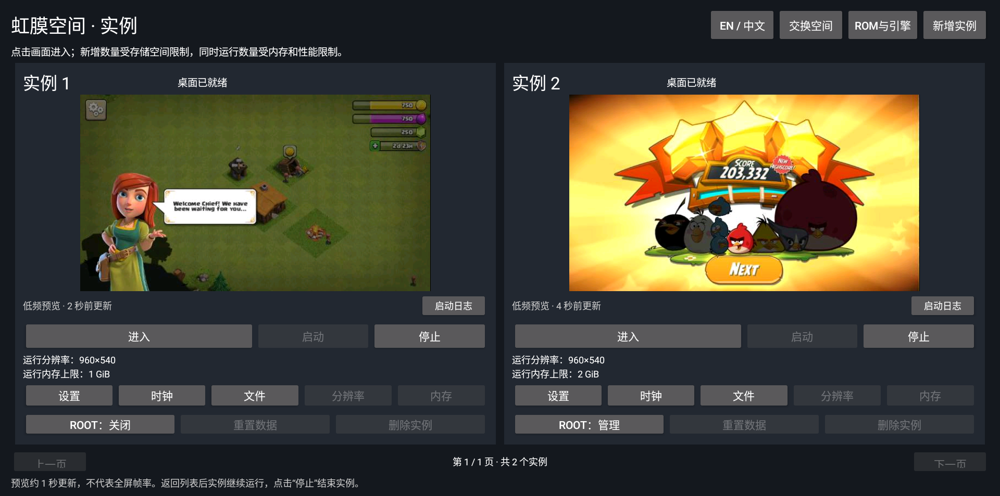

# 实机验收记录（v0.1.0 ～ v0.1.6）

**简体中文** · [English](en/validation.md) · [返回主页](../README.zh-CN.md)

> [!IMPORTANT]
> **验收记录原则**
> - 本记录严格区分**已实测通过项**、**遇到并保留的真实失败记录**以及**未验证/未通过的限制边界**。
> - 测试硬件为匹配的 **Raspberry Pi 4（AOSP 13 / ARM64 / 约 4 GiB 内存）**。
> - 旧参考工程（`Project Iris V3.0`）仅作只读基线核对；2026-10-15 经设备所有者明确授权正常关闭旧实例 `7` 及旧后台，保留其全部数据与配置且不再恢复。原始未脱敏日志、账号 HMAC 基线与未裁切截图均保存在本地忽略目录 `validation/private/` 中，不随仓库公开。

---

## 目录

1. [2026-10-27：v0.1.6 / e27 宿主交换空间与双游戏同屏验收（最新）](#1-2026-10-27v016--e27-宿主交换空间与双游戏同屏验收最新)
2. [2026-10-26～27：v0.1.5 / e25 Iris 命名迁移、存储/相机修复与应用兼容验收](#2-2026-10-2627v015--e25-iris-命名迁移存储相机修复与应用兼容验收)
3. [2026-10-24：v0.1.4 / e18～e21 实例内真实下载、天天象棋扫码、实时横竖屏与 Google Play 恢复](#3-2026-10-24v014--e18e21-实例内真实下载天天象棋扫码实时横竖屏与-google-play-恢复)
4. [2026-10-21：v0.1.3 / e17 User Namespace 身份隔离实机回归](#4-2026-10-21v013--e17-user-namespace-身份隔离实机回归)
5. [2026-10-15：v0.1.0 / e2 首次实机交付验收与真实宿主重启](#5-2026-10-15v010--e2-首次实机交付验收与真实宿主重启)

---

## 1. 2026-10-27：`v0.1.6 / e27` 宿主交换空间与双游戏同屏验收（最新）

### 宿主交换空间（Swap）实机验证
- **功能范围**：宿主 App 首页与实例列表新增“交换空间”页，支持 **关闭 / `1 GiB` / `2 GiB` / `4 GiB`** 切换、实时读取已配置/已启用/已用容量及宿主可用内存/磁盘状态，并支持通过用户已安装的宿主 Magisk 开启重启后自动恢复（最终版本：`0.1.6`、`versionCode 120`、引擎 `e27`）。
- **状态转换与重启恢复实测**：
  - 实机 UI 完整验证 `1 GiB → 4 GiB → 关闭 → 2 GiB（勾选自动恢复）`。
  - **真实宿主重启验证**：正常重启树莓派后，在未打开 App 也未从电脑执行任何命令的情况下，**2 GiB 交换空间开机自动恢复成功**。
  - **安全停用与复用验证**：在最终 APK 上验证“已开启自动恢复 → 关闭”会安全停用交换文件并仅移除本项目所属的 `/data/adb/service.d/irisbox-swap.sh` 脚本；再次启用相同容量时直接复用原文件与 inode，无需重新格式化写入。
  - **异常拦截与 `e26 → e27` 锁继承修复**：非法容量参数、符号链接、同名异物开机脚本及存在运行中实例时的变更请求均被正确拒绝。候选版 `e26` 在 Android `mksh` 下因额外文件描述符默认带 `FD_CLOEXEC` 而安全拒绝设置；`e27` 显式传递锁 FD 后实机通过，且双实例就绪后锁均正确释放，未被长驻子进程遗留占用。
- **构建与审计**：独立公开源码完整构建匹配 **52 项非浏览器载荷**与 **3 项浏览器未签名条目**；`53 / 116 / 11 / 54` 项输入摘要及 **372 项中英文语言资源**核验全部通过。覆盖更新最终 APK 时，两个运行中的实例会话保持不中断。

### 双游戏同屏运行验收结果与边界

| 验证维度 | 真实测试结果与明确边界 |
| :--- | :--- |
| **双开运行条件** | 同一台 4 GB 树莓派 4 宿主，开启 **2 GiB 宿主交换空间**；实例 1 为 `1024 MiB`（无 Google / 无 Root），实例 2 为 `2048 MiB`（保留 Google 与实例 Magisk）。**不代表两个 2 GB 实例并发或双全屏高帧率承诺。** |
| **《部落冲突》`18.647.5`** | 实例 1 使用设备内已由 Play 下载的 5 个正版同版本分包 APK 经其 `PackageManager` 安装（未复制账号或存档，亦不冒充第二次 Play 下载）。新手村庄正常加载并通过真实 Viewer 全屏点击推进对话；测试间歇出现的正常空闲断线已按游戏内置 `Reload Game` 重连（最终双开截图取自重连后画面）。**长期对战、部落战与充值支付未验证。** |
| **《愤怒的小鸟 2》`26.7.1`** | 在《部落冲突》同时运行期间，通过全屏触屏模式实际拉弓发射、命中击碎建筑、进入第二段房间并激活 Red 技能，**最终教程结算得分 203,332 分**（注：教程对偏离绿色引导线的角度显示红叉拒绝发射，对齐绿线后即正常发射，证实非输入通路故障）。 |
| **连续负载观测** | 连续采样 24 次（约 `146.8 秒`），两实例持续就绪，宿主最低 `MemAvailable` 为 `809,104 KiB`（约 `790.1 MiB`），两实例 `cgroup OOM-kill` 计数均为 `0`，列表预览序列持续递增。此为短时教程观测，**不代表长期稳定、全部关卡或固定帧率保证**。 |
| **数据保留与隔离核验** | 实例 2 的 Google 账号指纹、实例 `revision` 及两实例 User Namespace 身份再次通过严格核验（无 Host UID 0 回退）；宿主重启后旧参考工程保持停止，其脚本/配置/注册表完好如初。 |

---

## 2. 2026-10-26～27：`v0.1.5 / e25` Iris 命名迁移、存储/相机修复与应用兼容验收

### 内部包名与目录全面迁移
- **迁移范围**：经设备所有者明确授权，宿主包名迁移为 `com.irisbox.viewer`，设备运行根迁移为 `/data/irisbox`，内置浏览器与测试包迁移为 `com.irisbox.*`，原生启动器、音频服务、套接字与 cgroup 资源组统一采用 IrisBox 命名；管理端口 `19762`、实例编号、数据 `revision` 与 UID/GID 映射范围保持不变。共享 INET 分派器核验后复用，旧参考工程按授权保持停止。
- **停机事务与自动回退验证**：迁移前对两个实例的 `data` / `upper` / `vendor.upper` / `metadata` 完成独立 inode 的逐文件 SHA-256 备份。首次执行时因源脚本短变量名冲突触发自动回退并完整保护了数据；改用专用事务变量并停用旧显示指针后迁移一次通过。新包通过正常宿主 Magisk 界面重新获取 Root 授权（未手工篡改授权数据库）。

### 两项关键系统兼容性问题定位与修复
1. **YouTube 启动查询摄像头导致 ANR（`e24` 修复）**：精简配置此前将框架 `cameraserver` 替换为 `true`，导致 YouTube 启动查询摄像头数量时无限等待并触发 ANR。`e24` 恢复实例内原厂 `cameraserver` 框架服务，同时保持所有物理相机 Provider 禁用（`dumpsys` 正常返回 `0` 台摄像头），修复后原版 YouTube 正常进入播放。
2. **User Namespace 下外部存储目录创建失败（`e25` 修复）**：Linux 5.15 内核禁止非初始 User Namespace 修改 ext4 项目配额（Project Quota）状态，导致原厂 `vold` 在 `PrepareAppDirFromRoot` 阶段报错退出。`e25` 在匹配 AOSP 的独立临时目录中仅重编 `vold` 的 `Utils.cpp` 并重链接：仅在严格匹配 IrisBox 映射身份时跳过项目配额标签/继承，完整保留目录、UID/GID、权限模式、默认 ACL 及 FUSE 检查。修复后普通应用外部存储目录读写通过（**明确边界：当前 Profile 不提供实例内按应用的项目磁盘配额**）。

### `v0.1.5 / e25` 应用与功能实测结果

| 测试项目 | 实测结果与验收边界 |
| :--- | :--- |
| **Google Play 实际下载** | 在实例 2 内直接从 Play 商店下载并安装《部落冲突》、《愤怒的小鸟 2》与 YouTube（`installer=com.android.vending`），Google 账号私有 HMAC、GSF ID 与实例 `revision` 保持不变。**Play Protect 设备认证仍未通过。** |
| **《部落冲突》`18.647.5`** | 新手村庄正常渲染，通过真实虹膜空间全屏点击推进欢迎对话（年龄确认页不公开；长期对战、部落战与支付未验证）。 |
| **YouTube `21.42.243`** | 原版应用正常播放 Blender 官方《Big Buck Bunny》，播放进度从 `1:35` 持续推进至 `3:02`，全屏渲染与非零 PCM 音频输出正常（曾出现正常网络缓冲，不承诺 4K 或 DRM）。 |
| **《愤怒的小鸟 2》`26.7.1`（无 Swap 阶段）** | 在 `0.1.5`（宿主 `SwapTotal=0`）阶段，首次运行卡在启动页；经授权仅清除该游戏数据（`pm clear com.rovio.baba`，预先完成私有备份）后成功创建存档目录并进入 `Main` 场景，但随后提示 `You are offline / Please go online to complete the update`（见下图）。临时关闭实例 Root 的对照运行在 410 秒因宿主可用物理内存低于 512 MiB 被 watchdog 正常终止（`OOM-kill=0`），故在 `0.1.5` 中如实记为**关卡未通过**（直至 `0.1.6` 启用 2 GiB 宿主交换空间后通过）。 |
| **宿主界面语言持久化** | 343 项中英文资源核对一致；切换为 `English` 并重启宿主 App 后设置保持，切回 `简体中文` 正常，实例内部语言与会话不受影响。 |
| **双实例并发与安全隔离** | 实例 1（768 MiB）与实例 2（2048 MiB）同时桌面就绪，严格通过 UserNS 映射归属、错误 `start_tick` 拒绝、跨实例/Host UID 0 文件读取拒绝、无 `INTERNET` 权限网络拒绝、同名文件隔离及独立音频回归。 |

---

## 3. 2026-10-24：`v0.1.4 / e18～e21` 实例内真实下载、天天象棋扫码、实时横竖屏与 Google Play 恢复

### 启动准入排查与实例内真实下载链路（`e18 → e20`）
- **重启后内存准入排查**：用户重启宿主后实例 1 曾因内存上限被设为 `2560 MiB`（需 `2,883,584 KiB`）且旧工程实例 7 正在运行（占用约 1.4 GiB）而被准入保护正常拒绝。按授权正常停止旧实例 7 并将实例 1 恢复为 `768 MiB` 后，实例 1 在 `54,289 ms` 正常进入桌面，计数 `8` 与映射完好保持。随后按用户要求统一在实例 2（设为 `2048 MiB`）内执行单实例真实下载与安装验收。
- **内置下载浏览器（`com.irisbox.browser`）演进**：
  - 针对出厂 WebView 测试壳无下载能力的问题，`e18` 新增普通实例浏览器 `com.irisbox.browser`；`e19` 修复 `application/octet-stream` 下优先保留明确 `.apk` 文件名的逻辑；`e20` 修复预装更新时刷新父目录时间戳以触发 `PackageManager` 缓存更新（实测正确识别 `versionCode 2 / 1.0.1`）。
- **实例内真实网页下载与安装结果**：
  - **Via 浏览器 `7.3.3`（通过）**：在实例 2 内通过 `com.irisbox.browser` 从 Via 官网建立 `DownloadManager` 任务（`2,628,334 字节`，HTTP 200），经系统安装器授权并完成安装（普通 `UID 10094`，`installer=com.android.packageinstaller`），首次打开浏览正常。
  - **腾讯应用宝 `9.2.9`（通过）**：在实例 Via 浏览器中访问应用宝官网下载手机版 APK（`42,202,135 字节`），在系统提示旧目标版本兼容性警告时点击可见的 `Install anyway` 完成安装并正常打开在线首页（未关闭 Play Protect）。
  - **独立 QQ `9.3.75`（下载与安装完成，但因内存保护放弃登录）**：在实例应用宝内下载约 `374.82 MB` APK 并完成系统安装，但其大型安装编译及首次启动叠加应用宝后台保活进程触发了宿主可用内存低于 `512 MiB` 的保护。用户随后决定放弃独立 QQ 登录，改为直接下载《天天象棋》扫码登录（QQ 与应用宝保留数据并设为 `disabled-user` 以停止后台保活）。
  - **《天天象棋》`4.4.6.2` 下载、安装与扫码游玩（通过）**：在实例 Via 中从腾讯天天象棋官网直接下载 `198,465,378 字节` APK（文件 MD5 `99B32B44E4176F9157EA72B34A2E0758` 与 HTTPS 官网元数据完全一致），经系统安装器安装（普通 `UID 10097`）并生成原生微信/QQ 授权二维码；**设备所有者随后亲自扫码确认微信登录、QQ 登录及实际对局游玩均通过**。

### 实时横竖屏切换（`e21`）
- **实测结果**：`0.1.4 / e21`（`versionCode 118`）新增可信 `orientation.sh` 与全屏工具栏“横竖屏”按钮。在同一运行会话（`PID:start_tick` 不变）下实测切换横屏 `960×540` 与竖屏 `540×960`，宿主窗口键盘输入 `Iris9L` / `Iris8P` 准确送达，GPU 渲染与原计数保持；非法模式返回 `400`、失效会话返回 `409`；重启实例后竖屏设置持久保留，测试后恢复“跟随应用”。

### Google Play 商店目录恢复与设备认证边界
- **商店下载恢复（通过）**：仅通过 Android 标准接口清除 GMS 与 Play 商店的**临时缓存**（`pm clear --cache-only`）并触发正常 check-in 后，商店目录恢复显示，并实际从 Play 下载、安装、打开 **Open Sudoku `4.11.1`**（`UID 10098`）；随后在用户授权重建 GMS 服务数据并装回 11 个原版备份 APK（恢复至 `26.39.33`）及恢复实例 Magisk 后，无需重新登录又从 Play 实际下载、安装并打开 **Google 计算器 `9.3`**（`UID 10101`，`installer=com.android.vending`）。
- **Play Protect 设备认证（未通过）**：尽管当前实例的 GSF ID 已由用户完成自定义 ROM 官方登记且商店下载完全可用，但 Play 商店 `Settings → About → Play Protect certification` 仍显示 **`Device is not certified`**（Google 官方认证设备名单 54,261 行中无树莓派 `rpi4` / `aosp_rpi4` 条目，且当前为 `userdebug/test-keys` 构建）。本项目不篡改认证状态值、不伪造设备指纹，如实将“设备认证”记为未通过项（详见 [Google 商店恢复与认证说明](10_Google商店恢复与认证说明.md)）。

---

## 4. 2026-10-21：`v0.1.3 / e17` User Namespace 身份隔离实机回归

### 内核命名空间与数据迁移核验
- **停机备份与映射分配**：迁移前对两个保留实例（768 MiB 普通实例与 1536 MiB Google+Magisk 实例）建立独立 inode 完整备份并逐文件核对 SHA-256。原实例 ID、ROM 绑定、数据 `revision`、测试计数 `8` / `1` 及 Google 账号私有 HMAC 全部保持。

| 核验维度 | 实机核验结果 |
| :--- | :--- |
| **内核 UID/GID 映射** | 实例内 `root` 为 `0`，在宿主视图下分别映射至 `2000000000` 与 `2000100000`（每实例域 `100,000` 个 UID/GID，**Host UID 0 未映射**）。 |
| **七类命名空间归属** | `user` / `mnt` / `pid` / `net` / `ipc` / `uts` / `cgroup` 全部独立；其余六类命名空间通过 `NS_GET_USERNS` 核验其所有者均为各自实例的 User Namespace。 |
| **跨边界访问拒绝** | 错误 `PID:start_tick` 请求全部拒绝；实例内 `root` 可读取本域 `0600` 测试文件，但读取 Host `UID 0` 或另一实例映射域的 `0600` 测试文件均被内核拒绝。 |
| **首次映射启动耗时** | 原 768 MiB 普通实例首次映射启动耗时 `174,836 ms`（后续正常启动 `100,613 ms`）；原 1536 MiB Google 实例首次映射启动耗时 `78,097 ms`（后续正常启动 `67,905 ms`）。 |
| **新建纯 AOSP+Root 实例** | 1024 MiB 临时实例 `86,483 ms` 桌面就绪，无 Google，普通 UID 网络、GPU、PCM 音频、H.264 编解码及重置/删除全部通过（删除后其 UID 范围保留不复用）。 |

### 回归测试与候选版修复记录
- **全功能回归**：双实例真实全屏 FD 交接、混合大小写键盘输入 `Iris42Z`、触控滑动、返回列表重入、普通 UID HTTPS 200 / DNS / V3D GLES 渲染、无 `INTERNET` 权限拒绝、51 字节同名异文文件导入导出、10 张 JPEG 预览、Bearer 鉴权拦截（403）及音频助手终止后 `21.44 秒` 自动恢复均实测通过。
- **候选版演进（`e14 → e17`）**：`e14` 修复 Root 暂存变量顺序；`e15 → e16` 采用私有挂载命名空间内的 `/mnt` 临时绑定入口以兼容宿主 `0700` 根目录；`e16 → e17` 修复 BusyBox `sed` 正则兼容性并移除实例不接管的物理蓝牙声明。

---

## 5. 2026-10-15：`v0.1.0 / e2` 首次实机交付验收与真实宿主重启

*注：2026-10-15 同日后续完成的登录后回归（`v0.1.1 / e9`）与国际化发布验收（`v0.1.2 / e13`）分别详见 [07 登录后回归与修复](07_登录后回归与修复.md) 与 [08 国际化与发布](08_国际化与发布.md)。*

### 安装、归档安全与首次运行实测（`v0.1.0 / e2`）
- **11 项归档安全测试全通过**：生产级 `PackageArchive` 在 Android 实机上通过全部 11 项安全用例（正常包、错误 SHA-256、缺失文件、重复条目、未声明文件、超出声明大小、错误 Profile、路径穿越 `../`、绝对路径、错误首项、超大清单）。
- **早期失败与修复记录**：
  1. 修复 Git 文本换行转换破坏 Google 原始清单摘要的问题（通过 `.gitattributes` 锁定二进制/LF）。
  2. `e1` 首次启动因脚本调用 `irisbox_ns` 而包内仍为旧名 `iris_runtime_ns` 返回错误码 3；`e2` 统一二进制名称并增加 ELF 架构校验，将 `e1` 测试目录安全归档后重装通过。
  3. 验证 `512 MiB` 下限冷启动会触及内存限制，调至 `768 MiB` 后成功进入桌面。
  4. 文件交换连续请求遇到 `HTTP 423`（前次下载锁释放中），测试脚本加入有限等待重试后逐字节校验通过（未绕过服务端锁）。

| 测试操作（`v0.1.0 / e2`） | 实测结果 |
| :--- | :--- |
| **实例 1007 首次启动（768 MiB）** | `45,771 ms` 桌面就绪；全屏显示与触控点击正常。 |
| **实例 1008 首次启动（1024 MiB）** | `62,076 ms` 桌面就绪；双实例同时运行，列表预览各自独立更新。 |
| **普通应用联网与数据隔离** | 两实例内 Probe 均为普通 `UID 10084`，HTTPS 返回 200；全屏点击计数器分别保存为 `1` 和 `2`，重启 `1008`（`43,620 ms` 就绪）后数据保留且 `1007` 会话不变。 |
| **文件导入/导出与后台恢复** | 两实例分别导入导出同名不同内容的 51 字节 UTF-8 文件，SHA-256 完全一致；退出重开 App 或停止后台后由 App 自动恢复，两实例会话与数据保持不变。 |
| **临时实例 1009（Google + Magisk，1280 MiB）** | `88,216 ms` 桌面就绪；Play 服务与商店包存在，`/sbin/magisk -v` 返回 `30.7:MAGISK:R`；正常停止后测试重置与删除成功，不影响主实例。 |
| **真实树莓派宿主物理重启** | 宿主 `boot_id` 改变后，直接打开新 App 自动恢复后台，点击启动 `1007`（`42,083 ms`）与 `1008`（`46,919 ms`）进入桌面，原计数 `1` / `2`、普通 UID HTTPS 200 与共享 BPF 分派器核验全部通过。 |
