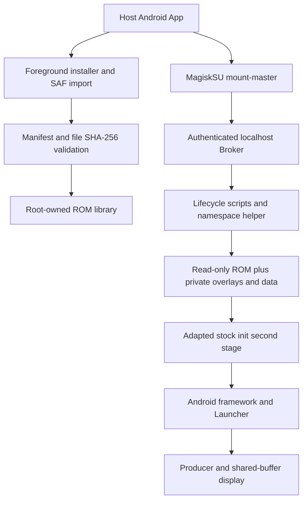

# Architecture and isolation

[中文](../02_技术架构.md)

The regular host APK requests root only through Magisk. A root `app_process` Broker listens on localhost port 19762 with a random bearer token. HTTP 202 means accepted, not completed; state polling verifies the actual guest session and desktop.

Instances share a Linux kernel. Each has User/mount/PID/network/IPC/UTS/cgroup namespaces, private BinderFS, system/vendor overlay upper/work directories, userdata and metadata. Since 0.1.3, Guest UID0 maps to a dedicated unprivileged Host range. There is no Host-UID0 fallback, CPU emulation or separate guest kernel. See [identity isolation and migration](userns.md). The root mount becomes private before pivoting; guest init manages services normally. Guest Root and Permissive do not constitute a security boundary against hostile workloads.

`revision` identifies a data generation; `session=PID:start_tick` identifies a running generation. Lifecycle locks, process identity checks, cgroup membership and mount ownership prevent operations on recycled IDs or stale sessions. Destructive requests also require the current revision and instance confirmation number.

## Separate resources

| Resource | Previous Iris | IrisBox |
|---|---|---|
| Host package | com.iris.viewer.buffer | com.irisbox.viewer |
| Runtime | /data/guest/iris_runtime_v1 | /data/irisbox/runtime |
| Manager port | 18762 | 19762 |
| Internal IDs | 7, 8, 23, etc. | 1007–1134 |
| veth | iris* | rv* |
| cgroup prefix | iris_runtime_ | irisbox_ |

The explicit shared exception is `/sys/fs/bpf/iris_inet_v1`, the host-global socket permission dispatcher. IrisBox verifies its identity and the host maps, then registers only its own netns-cookie/private-UID-map pairs. It never restores an old policy, removes another guest map or flushes host firewall rules. Fresh-host dispatcher creation is a separate unverified installation path.

## Display and media

List previews use bounded JPEG snapshots. Fullscreen uses the Producer/Gateway/JNI shared-buffer pipeline, fences and explicit release/acknowledgment; fullscreen frames do not travel through management HTTP. Input is bound to the same session with geometry checks and heartbeat cleanup.

AudioPolicy loopback captures guest playback as 48 kHz stereo PCM. Root-only token-protected sockets connect per-guest capture to a host AudioTrack; the host mixes outputs. Helpers are supervised and session-bound. Physical ALSA devices are not exposed, and microphone capture is not implemented. `audio.ready` proves active capture/playback progress, not an acoustic listening test.

The adapter restores mediaextractor and excludes unavailable V4L2 codecs from each private vendor view. Tested video uses software codecs. A private pre-init Traceur mask avoids unsupported kernel tracing; the original host APK and read-only ROM remain intact. See [SELinux](https://source.android.com/docs/security/features/selinux) and [BinderFS](https://docs.kernel.org/admin-guide/binderfs.html) for upstream behavior.
