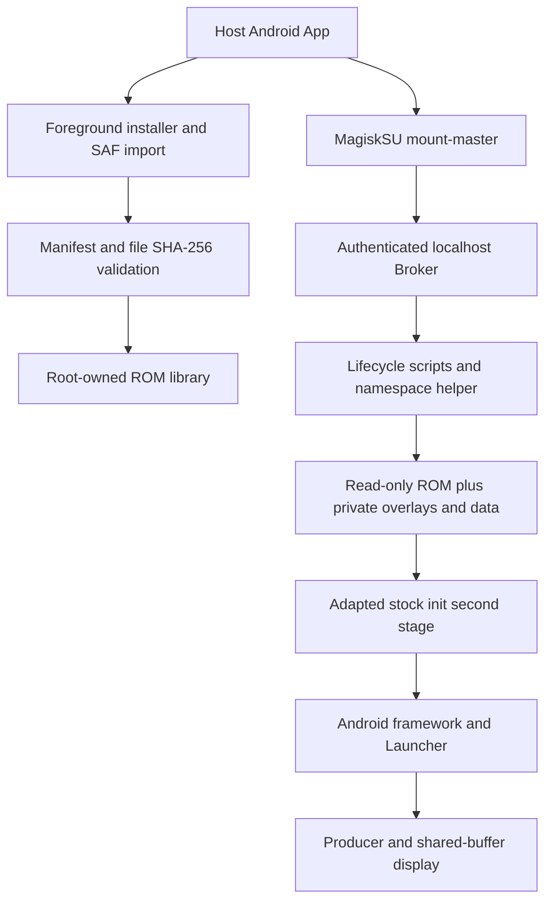

# Architecture and Isolation Boundaries

**English** · [简体中文](../02_技术架构.md) · [Back to README](../../README.md)

---

## 1. Execution & Control Flow

### Core Runtime Design
1. **Controlled Root Entry & Localhost Broker**: The regular host APK (`com.irisbox.viewer`) requests root strictly through Magisk (`su --mount-master`). A root `app_process` (`BufferBroker`) listens on `127.0.0.1:19762` protected by a random bearer token. `HTTP 202` indicates request acceptance rather than completion; state polling verifies the live guest session and desktop readiness.
2. **Seven Linux Namespaces & Shared Read-Only Base Images**: Instances share the host Linux 5.15 kernel and read-only `loop`/`ext4` mounts of `system.img` and `vendor.img`. Each instance owns isolated **`User` / `Mount` / `PID` / `Network` / `IPC` / `UTS` / `Cgroup`** namespaces, a private `BinderFS` instance, private `system`/`vendor` OverlayFS `upper`/`work` directories, `userdata`, and metadata. Since `0.1.3`, Guest `UID 0` maps to a dedicated unprivileged host UID block (`2000000000+`) with **no Host-UID0 fallback**, no CPU emulation, and no separate guest kernel (see [User Namespaces and Migration](userns.md)).
3. **Generational Identity & Lifecycle Guards**: `revision` tracks the persistent userdata generation, while `session = PID:start_tick` identifies a specific running init process. Lifecycle locks, `PID:start_tick` validation, cgroup membership, and mount-ownership checks prevent actions from hitting recycled PIDs or stale sessions. Destructive operations (`Reset` / `Delete`) additionally require the matching `revision` and instance confirmation number.

---

## 2. Resource Separation from the Previous Reference Project

| Resource Dimension | Previous Project (`Project Iris V3.0`) | IrisBox (`虹膜空间`) |
| :--- | :--- | :--- |
| **Host Package Name** | `com.iris.viewer.buffer` | `com.irisbox.viewer` |
| **Device Runtime Root** | `/data/guest/iris_runtime_v1` | `/data/irisbox/runtime` |
| **Manager Port** | `18762` | `19762` |
| **Internal Instance IDs** | `7`, `8`, `23`, etc. | `1007` – `1134` |
| **Host `veth` Prefix** | `iris*` | `rv*` (e.g., `rv1007h`) |
| **IPv4 Subnet** | `10.197.*.0/24` | `172.30.(ID-1000).0/24` |
| **Cgroup Prefix** | `iris_runtime_` | `irisbox_` |
| **Abstract Display Socket** | `iris_buffer_viewer_*` | `irisbox_viewer_*` |

### Explicit Shared Exception: Root Cgroup BPF Socket Dispatcher
Android attaches a single socket-create BPF program to the root cgroup. Replacing it would break the host or previous project. IrisBox therefore validates the existing `/sys/fs/bpf/iris_inet_v1` program and host maps, then registers **only its own `netns_cookie → private_uid_map` entries** for IDs `1007`–`1134`. It never executes a policy `restore`, never removes another project's guest maps, and never flushes host firewall chains. (Initializing the dispatcher on a fresh host that never ran the previous project remains a separate unverified installation path.)

---

## 3. Display, Input, Audio & Media Pipeline

- **Shared-Buffer Display & Session-Bound Input**:
  - Instance list cards poll bounded ~1 fps JPEG snapshots.
  - Fullscreen interaction runs in a dedicated `:display` process using the `Producer` → `Gateway` → `JNI` (`libirisbufferviewer.so`) hardware-buffer and fence release pipeline—fullscreen frames never pass through management HTTP. Pointer and keyboard input are bound to the verified `PID:start_tick` session with frame-geometry validation and heartbeat cleanup.
- **48 kHz Stereo PCM Loopback Audio**:
  - Guests use the ROM's virtual `default` audio HAL without exposing physical `/dev/snd`.
  - `AudioPolicy` loopback captures guest playback as `48 kHz / 16-bit / stereo PCM` over root-owned, token-protected UNIX sockets (`0700` dir / `0600` socket) connected via a credential-dropped helper to a per-instance host `AudioTrack`.
  - Helpers are supervised and bound to `PID:start_tick`; if terminated, the helper and host `AudioTrack` recover automatically without restarting the guest desktop. Microphone capture is not implemented, and `audio.ready` indicates active capture/playback progress rather than a physical acoustic test.
- **Software Video Decoding & Pre-Init `Traceur` Mask**:
  - A post-loaded product RC (`zzz_irisbox_media.rc`) restores `mediaextractor` and removes unavailable `V4L2` hardware codec includes from each guest's private vendor configuration so MP4 / H.264 playback runs cleanly on stock software codecs (DRM is not covered).
  - Before guest `init` starts, an empty `tmpfs` masks `rootfs/system/app/Traceur` inside the guest's private mount namespace to avoid unsupported kernel-tracing crashes while leaving the read-only ROM and host APKs untouched.
- **Upstream References**: [Android SELinux](https://source.android.com/docs/security/features/selinux) · [Linux Kernel BinderFS](https://docs.kernel.org/admin-guide/binderfs.html) · [Android Storage Access Framework](https://developer.android.com/training/data-storage/shared/documents-files).
